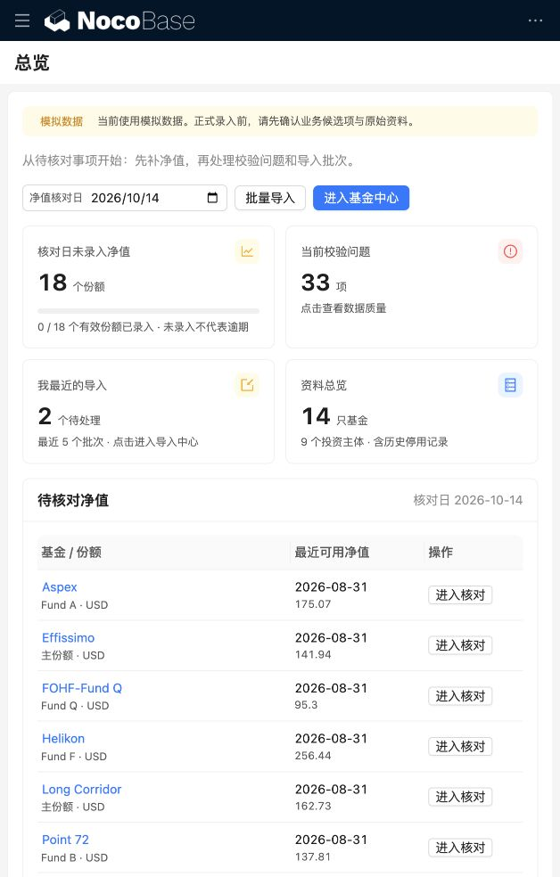

# Folio Ledger · 组合账簿

Folio Ledger 是面向基金业务的组合账簿，覆盖数据录入、核对与追溯。

基于 **NocoBase 2.2.24 + React + PostgreSQL** 的业务工作空间。将分散在 Excel 中的基金资料、投资主体、申赎交易和净值集中维护，让录入、校验、来源追溯和数据导出在同一系统内完成。

当前重点是**把数据录准、存好、查得清楚**。客户月报（Return Tracker 报告计算）已在系统内按「生成 → 校验 → 复核发布」运行，自动生成 Slides 尚未实现。

<p align="center">
  
</p>

*当前版本的实际工作台，使用模拟数据。截图为窄屏布局，顶部与左侧菜单自动折叠；桌面双导航见[基金中心截图](docs/verification/native-navigation/fund-nav.png)。全新安装不会自带截图中的数据和数据库页面配置，下面教程分别说明如何准备。*

## 能做什么

| 业务入口 | 主要用途 |
| --- | --- |
| 工作台 | 查看待补净值、校验问题、最近导入，直接进入处理页面 |
| 基金中心 | 维护基金、份额、净值与收益、自营成分及文档附件 |
| 客户中心 | 按客户编号管理投资主体，分别核对各主体持仓 |
| 报告中心 | 查看本月出报告进度，生成、逐条确认校验发现并发布月报，对比同一主体同一月份的两个版本，查阅已发布归档 |
| 数据作业 | 录入申赎；上传文件、匹配字段、纠错、预览后提交；导出业务表 |
| 业务设置 | 维护字段候选值、基准数据、基金历史资料和权限相关入口 |

- 严格保留字段来源映射；客户 → 投资主体 → 基金份额，通过交易形成持仓。
- 交易按历史持仓校验；批量提交失败时整批回滚，重试不重复入库。
- 金额、份额与比例使用精确十进制；导出保留原值，空值与零明确区分。
- 草稿和导入批次按用户隔离；支持只读、录入、候选配置角色。
- 顶部与左侧导航使用 NocoBase 官方能力，业务表单由 Finance 插件提供。

## 从 clone 开始：本地运行教程

这条流程面向**本地演示与开发**。已验证环境为 macOS、Node.js 24.19.0、Python 3、PostgreSQL 17.9；Linux 需自行安装同等依赖，Windows 原生脚本未验证。以下命令使用 bash/zsh，全部在仓库根目录执行。

### 1. 获取仓库

这是私有仓库。先确保 GitHub 账户已获访问权限；浏览器或 Git 显示 404 时，先检查登录账户和授权。

```sh
git clone https://github.com/iancaoo/folio-ledger.git
cd folio-ledger
```

HTTPS 克隆使用 GitHub 的凭据管理器或 Personal Access Token，不使用账户密码。已配置 SSH 的用户也可执行 `git clone git@github.com:iancaoo/folio-ledger.git`。

### 2. 准备运行环境

需要 Git、Node.js **24**（含 npm）、Python 3，以及 PostgreSQL **17** 的 `initdb`、`pg_ctl`、`psql`。无需自行创建数据库，也无需安装全局 Yarn。

macOS 已安装 Homebrew 时，可以使用：

```sh
brew install node@24 postgresql@17 python
export PATH="$(brew --prefix node@24)/bin:$(brew --prefix postgresql@17)/bin:$PATH"
export FINANCE_NODE="$(command -v node)"

node --version
npm --version
python3 --version
initdb --version
pg_ctl --version
psql --version
```

确认 Node 输出 `v24.x`，PostgreSQL 工具输出 `17.x`。`FINANCE_NODE` 明确指定项目使用的 Node；新终端需重新设置，或将上述环境变量写入自己的 shell 配置。用普通用户执行，不要用 `sudo` 启动项目数据库。

默认端口为应用 `13000`、数据库 `15432`。本项目自行管理独立 PostgreSQL 实例，不需要执行 `brew services start postgresql@17`。

### 3. 首次安装并启动

```sh
python3 scripts/setup-local.py
```

该脚本会依次：

1. 安装项目内固定版本的 Yarn 与 TSX。
2. 在 `.runtime/postgres` 创建并启动 PostgreSQL，生成本地密码及应用配置。
3. 按锁文件安装 NocoBase 依赖，构建 Finance 插件。
4. 初始化平台、业务表及角色，启动应用。

成功时终端输出 `Ready: http://127.0.0.1:13000/admin/finance`。第一次安装需要下载依赖。失败时查看 `.runtime/setup.log`；修复依赖或网络后可重新执行。已有数据库会执行 `upgrade --skip-code-update`，不会自动清空数据。

安装不依赖 Codex、原始交接 Excel 或其他项目的配置。`.runtime` 和 `.env` 会在本机生成，不应从别人的工作目录复制。

### 4. 登录并确认基本页面

打开 **<http://127.0.0.1:13000/admin/finance>**。

- 管理员账号：`admin@finance.local`。
- 密码：在本机编辑器中打开 `.runtime/dev-credentials.json`，读取 `admin_password`。不要提交或分享该文件。
- 新数据库先显示 Finance 内置业务工作空间；空列表属于正常情况。
- 已配置原生页面的数据库会自动跳转到新版工作台。

此时即可使用业务功能。要复现截图中的官方双导航，再完成第 6 步。

### 5. 创建入门数据，核对第一个结果

应用运行后执行：

```sh
NODE_PATH="$PWD/apps/nocobase/node_modules" \
  node .runtime/tooling/node_modules/tsx/dist/cli.mjs scripts/seed-demo.ts
```

脚本只允许在模拟模式运行，并使用固定请求键，重复执行不会追加同一笔入门交易。它创建一只演示基金、两个投资主体，以及第一主体的申购 100 份、赎回 30 份和净值 1.25。

进入“客户中心 → 持仓核对”，选择入门演示主体 A，将截至日期设为 **2026-01-03**。核对：

| 项目 | 初始预期 |
| --- | --- |
| 持有份额 | 70 |
| 单位净值 | 1.25 |
| 原币市值 | 87.50 USD |

对象 ID 保存在 `.runtime/demo-records.json`。如后续修改了这些记录，结果会随数据变化。仓库只提供通用入门数据，不包含截图中的完整数据集或真实客户资料。

### 6. 初始化官方顶部 + 左侧导航

**这一步不能由 clone 自动完成。** 菜单、页面和区块实例存在数据库中；仓库提供创建脚本和业务区块代码。首次部署只需配置一次。

先将已验证版本的官方 CLI 安装到本项目，不安装全局 Skills：

```sh
npm install --prefix .runtime/tooling --no-audit --no-fund @nocobase/cli@2.2.24
export PATH="$PWD/.runtime/tooling/node_modules/.bin:$PATH"

nb env add finance-local --api-base-url http://127.0.0.1:13000/api --auth-type basic
```

在交互提示中填写第 4 步的管理员账号和密码。CLI 会在用户目录保存连接配置；若同名环境已存在，使用 `nb env use finance-local`，需要重新登录时使用 `nb env auth finance-local`。

```sh
nb env use finance-local
python3 scripts/setup-native-navigation.py
```

脚本创建 **6 个顶部分组、20 个页面**，已有页面不会被替换。然后在浏览器以管理员身份逐页操作：

1. 打开相应页面，点击顶部“界面配置”（画笔图标）。
2. 点击“创建区块”，选择名称对应的 `Finance …` 区块。例如“总览”选 `Finance 总览`，“基金列表”选 `Finance 基金列表`。
3. 每页只放一个对应区块。完成后退出界面配置。

完整对应关系见 [navigation.json](apps/nocobase/packages/plugins/@finance/plugin-core/src/shared/navigation.json)。页面顺序可在官方菜单配置中调整；建议按工作台、基金中心、客户中心、报告中心、数据作业、业务设置排列。

挂载完成后重新生成本机页面清单，并给初始化的业务角色添加菜单权限：

```sh
python3 scripts/setup-native-navigation.py
nb api acl roles desktop-routes add --role-name finance_reader --body-file docs/navigation/access-business.json -j
nb api acl roles desktop-routes add --role-name finance_editor --body-file docs/navigation/access-business.json -j
nb api acl roles desktop-routes add --role-name finance_configurator --body-file docs/navigation/access-configurator.json -j
```

访问 `/admin/finance` 应跳转到原生工作台；点击顶部“基金中心”，左侧应出现基金列表、净值与收益、成分核对、文档附件。录入角色与只读角色不应看到“字段候选配置”。

**不要直接复用仓库中原机器的页面 UID 或权限 ID。** 上述脚本会更新 `docs/navigation/installed-pages.json` 和 `access-*.json`，ACL 命令必须使用目标实例刚生成的文件。页面为空通常意味着只建好了页面外壳，还未挂载业务区块。详见 [导航迁移与恢复](docs/原生双导航迁移.md)。

### 7. 开始录入与导入

推荐按以下顺序试用：

1. **基金中心**：创建基金与份额，维护 ISIN、币种等基础资料。
2. **客户中心**：创建投资主体，用客户编号归组。
3. **交易录入、净值与收益**：录入事实数据，再查看持仓。
4. **导入中心**：选择类型 → 下载模板及对象参考 → 上传暂存 → 匹配字段 → 纠错与预览 → 提交。
5. **数据质量**：从问题进入对应记录，修正后刷新检查。
6. **数据导出**：选择业务表及范围，下载 Excel；大批量结果按规则打包为 ZIP。

附件上传只保存基金资料，不会自动识别文件或填写净值。个人草稿不会写入正式业务表，需要主动保存。

## 日常启动、停止与更新

已安装环境不必每次执行完整安装：

```sh
python3 scripts/dev-database.py start
python3 scripts/dev-app.py start
python3 scripts/dev-app.py status
```

停止时先停应用，再停数据库：

```sh
python3 scripts/dev-app.py stop
python3 scripts/dev-database.py stop
```

修改插件代码后重新构建并重启：

```sh
node .runtime/tooling/node_modules/yarn/bin/yarn.js --cwd apps/nocobase build @finance/plugin-core
python3 scripts/dev-app.py restart
```

拉取新代码后，若包含依赖或迁移变化，可重新执行 `python3 scripts/setup-local.py`。在重要数据环境中先按 [部署与恢复](docs/部署与恢复.md) 备份；Git 保存代码，不备份数据库和上传文件。

## 验证与排错

所有测试命令都从仓库根目录执行，并使用 Node.js 24。

```sh
# 领域与数据库测试：使用独立 finance_test 数据库
NODE_PATH="$PWD/apps/nocobase/node_modules" \
  node .runtime/tooling/node_modules/tsx/dist/cli.mjs --test tests/domain.test.ts tests/database.test.ts

# HTTP 测试：需要应用运行，且 FINANCE_DEMO_MODE=true
NODE_PATH="$PWD/apps/nocobase/node_modules" \
  node .runtime/tooling/node_modules/tsx/dist/cli.mjs --test tests/api.test.ts
```

数据库测试会重建测试库。HTTP 测试会向开发库添加模拟记录、创建测试账号并重启应用，不要与浏览器验收同时运行。未初始化原生导航时，对应导航权限测试会跳过。

| 现象 | 检查方式 |
| --- | --- |
| 克隆或打开仓库得到 404 | 确认 GitHub 登录账户拥有私有仓库权限 |
| 提示缺少 `initdb` / `pg_ctl` / `psql` | 将 PostgreSQL 17 的 `bin` 加入 `PATH` |
| Node 版本不匹配 | `node --version` 应为 24；检查 `FINANCE_NODE` |
| 安装失败 | 查看 `.runtime/setup.log`，修复原因后重跑安装脚本 |
| 页面打不开 | 检查两个服务状态、13000/15432 端口及 `.runtime/nocobase-local.log` |
| 原生页面为空或普通用户没有菜单 | 完成区块挂载，并用当前实例生成的 ID 配置角色菜单权限 |
| 正式模式不能保存 | 检查业务候选值是否已经确认，勿用演示选项代替业务决定 |

最近一次验证（2026-10-15）：插件构建、136 项领域与数据库测试、23 项 HTTP 测试（含客户月报）通过；月报计算与 `apps/return-report` 的 Python 原型逐项一致。历史领域、浏览器、性能和恢复证据见 [开发进度](docs/开发进度.md)，不代表每次前端修改后都完整重跑。部分旧浏览器脚本仍需适配原生导航。

## 项目结构

```text
apps/nocobase/                         固定版本平台工程与锁文件
  packages/plugins/@finance/plugin-core/
    src/client/                       现有业务页面与表单
    src/client-v2/                    原生页面的 Finance 区块适配
    src/server/                       领域接口、模型与迁移
    src/server/report/                客户月报计算、校验与 HTML 渲染
apps/return-report/                   月报 Python 原型与一致性核对
    src/shared/                       字段映射与共用规则
schema/                               字段清单与验收定义
scripts/                              安装、运行、导航、备份与打包工具
tests/                                领域、数据库、HTTP、浏览器验证
docs/                                 设计、操作、部署与验证记录
.agents/skills/                       项目内 NocoBase Skills
.runtime/                             本机生成的数据库、凭据与日志（不提交）
```

当前工程保留已验证的 2.2.24 插件入口与 `/admin` 路由；不要直接套用面向其他 NocoBase 版本的目录或 URL 约定。

## 文档与交付边界

- [项目目标](GOAL.md) · [端到端需求设计](docs/Finance系统端到端需求设计.md)
- [详细使用与开发参考](docs/使用与开发参考.md)：导入、交换、精度、草稿、文件处理与测试脚本
- [原生双导航迁移](docs/原生双导航迁移.md) · [CLI 与 Skills 接入](docs/AI开发接入.md)
- [部署与备份恢复](docs/部署与恢复.md) · [试用与业务确认](docs/试用与业务确认.md)
- [第一阶段验收记录](docs/第一阶段验收记录.md) · [开发进度](docs/开发进度.md)

当前状态是**本地技术交付完成，待业务确认与生产部署**。默认 `FINANCE_DEMO_MODE=true`；正式使用前须确认字段缺口、候选值、角色、备份和部署配置。真实资料、运行凭据、数据库及用户上传文件不随仓库分发。项目依赖 NocoBase 及第三方组件，其许可分别遵循各自声明。
