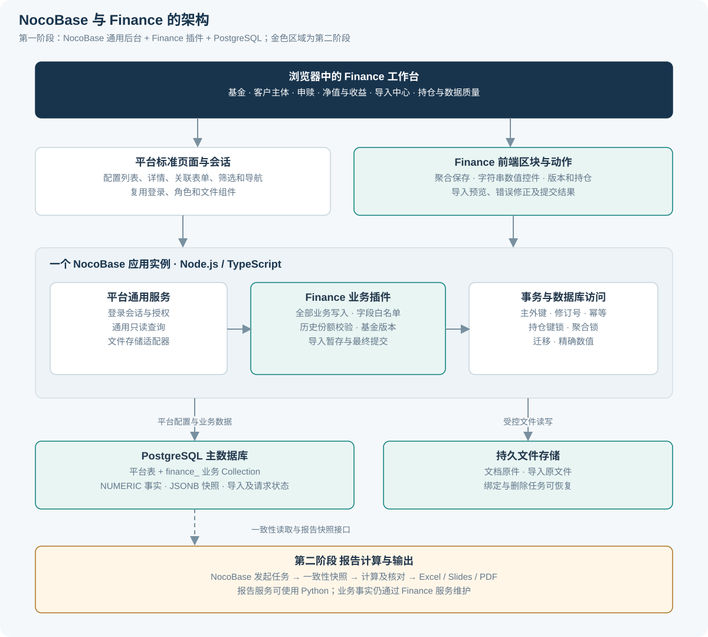
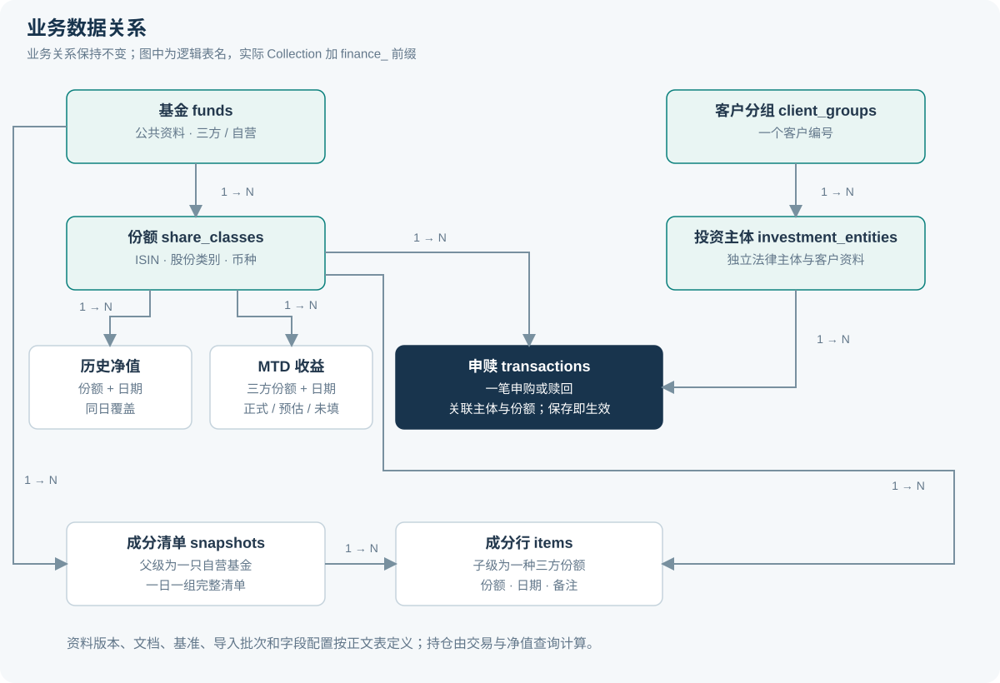
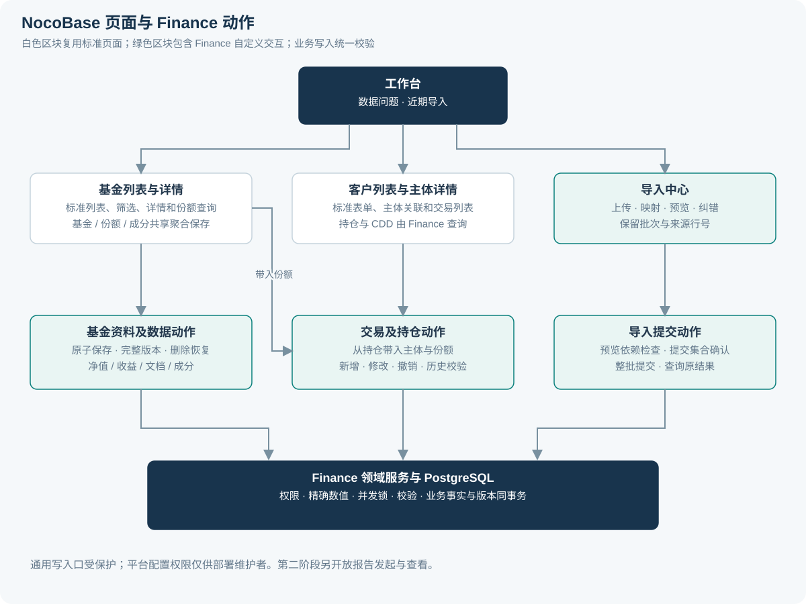
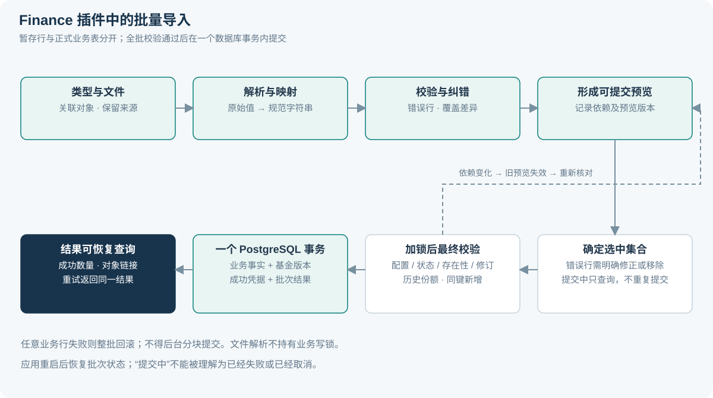

# Finance 系统端到端需求设计

版本：V0.2　日期：2026 年 10 月 13 日　状态：NocoBase 技术路线已确认，部分业务细节待确认，技术能力待验证

本系统用于集中录入基金、客户、申赎、净值、收益和文档，减少跨 Excel 查找、重复填写和人工核对。第一阶段交付可追溯的业务记录和可用的录入流程。第二阶段基于这些记录统一计算报告数据，再生成 Return tracker 样式的 Excel 和 slides。

业务字段以《数据字段清单_20260928.xlsx》为准。已接受的六项建议作为设计基线；进一步提出的操作细节明确标为本版设计选择。未定义的业务信息不由系统或 AI 推测。

本版采用 **NocoBase + Finance 业务插件 + PostgreSQL**。标准列表、表单、导航、登录和权限复用平台能力；业务保存、历史份额校验、导入纠错、精确数值及基金版本由 Finance 插件实现。第一阶段继续聚焦录入，第二阶段再处理报告。

### 本次复查与修订

| 复查项 | V0.2 的处理 | 主要章节 |
| --- | --- | --- |
| 独立前后端与 SQLite 假设 | 改为 NocoBase 应用、TypeScript 插件和 PostgreSQL；Python 保留为第二阶段可选报告服务 | 3、10、11 |
| 平台配置与业务开发边界 | 逐页区分配置项、自定义区块及自定义保存动作 | 3.3、5.2 |
| 通用接口可能绕过校验 | 业务写入统一进入领域服务，关闭通用写入口并设置服务端防护 | 3.4、7、9 |
| 并发交易与整批提交 | 增加持仓键锁、基金聚合锁、预览依赖检查与请求幂等协议 | 3.2、6.5、6.6、9 |
| 精确数值与平台默认字段 | 使用 PostgreSQL NUMERIC、字符串 API 和十进制计算；明确系统用户及修改人字段边界 | 4.2、4.3、4.5 |
| 交付、许可与验收 | 社区版加自研插件为第一阶段基线；增加 M0 技术验证、升级恢复和绕过校验测试 | 3.5、11、12、13 |

附录 A 的六个工作表、161 条原字段或规则映射保持不变。上述变化是实现方式与技术约束的调整，不改变已接受的业务口径。

## 1 目标与阶段边界

### 1.1 业务目标

- 用户在一个系统内完成资料维护、交易录入、净值与收益导入，不再靠文件之间的行号或名称建立关系。
- 相同事实只维护一次。手工录入与批量导入使用同一套校验规则。
- 错误定位到记录、字段和原因。用户可以直接修正，不需要重新检查整个文件。
- 历史引用保持有效。资料改名、软删除或净值覆盖，不应让已有交易失去归属。
- 第二阶段的 Excel 与 slides 使用同一份报告数据，避免两套结果独立维护。

### 1.2 阶段范围

| 能力 | 第一阶段 数据录入与管理 | 第二阶段 报告处理与输出 |
| --- | --- | --- |
| 基金及份额类别 | 新增、修改、查询、软删除、恢复、版本查看 | 报告显示及历史快照 |
| 客户及投资主体 | 新增、修改、查询、软删除、恢复 | 单主体报告与明确选择的合并报告 |
| 申赎 | 单笔录入、批量导入、修改、撤销、历史份额检查 | 现金流取数、收益口径与 IRR |
| 净值及 MTD 收益 | 上传、预览、纠错、覆盖、单条补录及删除 | 月度选值、YTD、预估和正式值参与规则 |
| 自营基金成分 | 完整成分清单、同币种市值权重、缺数提示 | 汇率换算与更完整的组合分析 |
| 客户持仓 | 原表要求的份额、最新净值、净值日期、市值 | 报告日期估值与历史报告复现 |
| 基准与文档 | 维护、上传和查看 | 基准比较与报告引用 |
| 数据质量 | 字段及关联校验、缺数清单、导入结果 | 报告就绪检查及指标核对 |
| Excel 与 slides | 仅提供业务数据导出及供第二阶段读取的接口 | Return tracker、slides、报告快照 |
| Lark 邮箱及 AI | 不接入自动抓取；允许已有资料手工录入或文件导入 | 有明确来源和人工核对流程后再接入 |

第一阶段的持仓、CDD 截止日期和成分权重属于原表规定的页面计算，不等于启动报告计算项目。底层穿透和近期点评因原表缺少字段定义，保留位置与缺口说明，不创建臆测字段。

### 1.3 用户与使用假设

初期按一个 NocoBase 应用实例、一个 PostgreSQL 实例和少量同时录入用户设计。两者可以部署在同一台服务器，通过浏览器访问；数据库仅供服务端连接。工作分为资料维护、运营录入和结果查看，不增加业务审批角色。

本版使用业务管理员、编辑者、只读者三类业务角色。业务管理员维护人员授权、候选枚举及恢复操作；编辑者维护授权业务记录；只读者查询和按权限导出。部署维护者另持平台配置账号，用于建模、页面发布、插件安装和备份恢复，不作为日常业务账号。平台配置权限不得默认授予所有编辑者。

具体人员授权在部署时配置。原表未要求的多级审批、客户门户、复杂行级权限和 Lark 单点登录不纳入第一阶段。采用平台登录机制，不再自建密码和会话系统。

## 2 需求依据与规则优先级

### 2.1 依据

1. 用户在本次对话中确定：严格按字段清单建模，优先解决录入，报告处理放到下一阶段。
2. 用户接受基金与份额分层、客户与主体分层、交易补充主体关联、撤销语义、市值权重及收益选值的建议。
3. 字段清单实际包含六个工作表：三方基金页面、自营基金页面、客户页面、申赎记录、基准页面、净值与文档。
4. 交接说明用于理解业务分层。Return tracker 和此前复刻结果用于第二阶段的计算参考，不能替代真实交易记录。
5. 用户已确认采用 NocoBase，并接受配套 PostgreSQL。平台改变实现方式，不替代原字段清单与业务规则。

### 2.2 规则状态

| 标记 | 含义 | 实现方式 |
| --- | --- | --- |
| 原表规则 | 字段、类型、必填、操作和明确公式 | 保留；与已接受补充冲突时记录差异 |
| 已接受补充 | 用户已接受的六项业务方案及 NocoBase 技术路线 | 作为本版设计基线，不重复要求批准 |
| 本版设计选择 | 为实现流程补齐的技术或交互细节 | 可用于原型；评审时可以调整 |
| 待确认 | 原表未给出完整枚举、公式或业务含义 | 明确缺口及受影响功能，不猜测后写入正式数据 |

原表 F 列为“是”的字段按必填实现；“否”按选填实现；空白暂按选填，并保留未明确的标记；“-”属于系统、规则或计算项。三方基金表头的“请确认是否必填”作为整体待确认事项保留。

原表中的“建议删除”“建议改成数值”“建议新增日期”不是已执行的变更。约会与业绩负责人仍保留；基金费率及自营基金现金余额仍保留原文本类型；税务居民地和城市仍为文本。

### 2.3 已接受的业务基线

| 编号 | 规则 | 结果 |
| --- | --- | --- |
| D01 | 基金与份额类别分层 | 交易、净值、收益关联 share_class_id；公共资料关联 fund_id |
| D02 | 同一客户编号允许多个投资主体 | 交易与持仓按 entity_id 计算；合并报告必须明确选择 |
| D03 | 交易必须关联主体与份额类别 | 页面带入上下文或要求选择；数据库外键不可为空 |
| D04 | 录入即生效，撤销后不参与计算 | 无审批流；保留被撤销交易；修改或撤销不能破坏历史份额约束 |
| D05 | 成分按同日完整清单及市值计算权重 | 分母为已列示成分的总市值；缺数或多币种时不给出误导性权重 |
| D06 | 正式值优先，预估 MTD 按月选一条 | 第一阶段保存原始记录和标记；第二阶段实现报告选值 |

## 3 系统架构

### 3.1 模块分工

| 模块 | 负责事项 | 边界 |
| --- | --- | --- |
| NocoBase 页面与通用能力 | 列表、筛选、详情、关联选择、登录、角色权限、文件能力 | 业务角色使用已发布页面；通用保存按钮不能绕过 Finance 规则 |
| Finance 前端插件 | 聚合表单保存、精确数值输入、导入预览纠错、持仓及版本区块 | 嵌入 NocoBase 页面，复用会话；不另建独立前端应用 |
| Finance 服务端插件 | 字段元数据、校验、基金版本、交易与撤销、持仓和成分查询 | 使用 Node.js／TypeScript；所有业务写入共用领域服务 |
| 导入模块 | 解析 xlsx／xls／CSV、临时行、映射、预览、最终提交 | 属于 Finance 插件；预览不写正式业务表 |
| 数据访问与迁移 | 复用平台数据库连接及事务，管理 Finance Collection、约束和迁移 | 不修改平台内核；不得在事务外漏写关联表 |
| PostgreSQL | 平台配置与结构化业务数据、导入批次、请求凭据、业务版本 | 使用主数据源；逻辑区分平台表与 finance_ 业务表 |
| 文件存储 | 文档原件和导入原文件 | 复用可用的文件存储适配器；下载与删除受业务权限控制 |
| 报告服务 | 第二阶段的日期取数、计算、快照、Excel 与 slides | 读取受控数据快照；不直接修改业务事实 |

本版规划一个独立的 `@finance/plugin-core` 插件，同时包含前端区块、字段组件和服务端逻辑。插件名称是本项目设计名称，不代表已有官方插件。Collection、接口、迁移与校验规则进入代码版本管理；页面配置也必须有可重放的初始化或发布方法。使用官方扩展机制，不通过修改 NocoBase 内核实现业务。[服务器插件](https://docs.nocobase.com/plugin-development/server/plugin)、[Collection 定义](https://docs.nocobase.com/plugin-development/server/collections)

### 3.2 PostgreSQL 与事务约定

当前 NocoBase 官方主数据库列表包含 PostgreSQL，没有列出 SQLite 或 DuckDB。本项目按 PostgreSQL 主数据源交付；SQLite 不再作为第一阶段数据库，DuckDB 仅保留为第二阶段分析工具的候选。[数据源支持](https://docs.nocobase.com/data-sources/)

- 初期采用单应用实例和本地持久卷；平台表与 Finance 表使用同一个 PostgreSQL 数据库，以便共享受控事务。数据库版本和镜像摘要在 M0 固定到平台支持且验证通过的版本。
- 文件解析、行级预览及文件上传在正式业务事务之外进行。基金与子表及版本、单笔交易与校验、整批提交分别使用一个事务；不能逐行提交后声称整批原子化。
- 可变业务记录使用 `technical_revision`。更新时原子比较并递增，冲突返回 409；时间戳不能代替修订号。
- 同一基金的公共资料、份额条款和成分保存先锁定基金聚合，再生成唯一业务版本。新建基金及其第一份额作为一次聚合创建。
- 同一主体加份额的交易写入通过技术锁记录串行检查。修改主体或份额时同时锁旧键与新键，并以固定顺序加锁。不能只锁被修改交易：两笔独立赎回也可能争用同一持仓。
- 同日时序值的覆盖、首次插入及软删除关联校验，都需在加锁后重新判断。依赖对象的状态、存在性和修订号必须与提交条件一致，避免预览后新增同键记录被静默覆盖。
- 请求凭据、正式数据和成功结果在同一事务提交。锁等待、死锁或连接错误只作有限重试；重试仍使用原幂等键，客户端可以查询结果。

行锁是本项目并发策略的基础；具体锁顺序和隔离级别需在 M0 用同时赎回、首次插入和删除冲突样例验证，不能仅凭平台支持事务就认定业务正确。[PostgreSQL 锁机制](https://www.postgresql.org/docs/16/explicit-locking.html)

### 3.3 配置与开发边界

| 能力 | 复用平台 | Finance 必须实现 |
| --- | --- | --- |
| 模型与页面 | Collection、关联字段、表格、表单、详情和筛选 | 原表字段元数据、物理映射、原子聚合保存 |
| 登录与授权 | 平台用户、会话、角色和动作权限 | 自定义动作注册权限、记录及字段权限、受保护表写入防护 |
| 数值与计算 | 展示容器及字段扩展机制 | 字符串数值控件、十进制转换、持仓、CDD、成分权重 |
| 业务版本与删除 | 历史页面和操作按钮的容器 | 基金快照、一次保存一个版本、软删除及恢复、文档物理删除补偿 |
| 批量录入 | 上传组件与表格容器 | 文件解析策略、暂存、逐行纠错、过期检查、整批原子提交及幂等 |
| 查询与导出 | 权限过滤、列表和筛选 | 计算查询、精确数值导出、来源定位与可再导入的业务 ID |

平台基础导入能生成模板并导入 Excel，但默认数值转换包含将某些文本转为空值等行为。本项目需要保留原值并显式处理异常，因此不把通用导入作为正式业务录入入口。[基础导入](https://docs.nocobase.com/interface-builder/actions/types/import)

### 3.4 业务写入边界

所有 Finance 业务表和子表均为受保护 Collection。日常页面可以复用通用查询；创建、更新、删除、恢复、关联变更和批量导入统一调用 Finance 动作。保护同时覆盖父表、子表、关联 API、嵌套保存、批量动作、工作流及通用导入。

1. 为业务角色关闭受保护 Collection 的通用写动作；页面的保存、撤销及恢复按钮绑定 Finance 动作。
2. 服务端对受保护资源设置拒绝通用写入的防护，并在数据写入层检查内部领域调用上下文及事务。内部标记不得由客户端参数提供；测试必须覆盖平台高权限会话的通用写入路径。
3. 自定义动作检查权限、字段白名单、关联合法性与技术修订号，再调用同一领域服务。调用者不能指定系统版本、来源批次、删除标记等受控字段来绕过动作语义。
4. 数据库另设真实外键、唯一键及必要检查约束。业务计算不放在提交后异步工作流中补救；仅在提交成功后刷新界面或失效缓存。

部署维护者仍可通过数据库管理工具改变数据，因此生产库写凭据只交给受控应用和维护流程。绕过应用的修复需离线校验与恢复预案；本版不承诺抵御数据库超级用户。权限配置及插件防护是交付的一部分。[服务端 ACL](https://docs.nocobase.com/plugin-development/server/acl)

### 3.5 版本与插件依赖

| 项目 | 本版基线 |
| --- | --- |
| NocoBase | 以 2026-10-13 核对的稳定版本 v2.2.23 作为 M0 起点；验证后固定版本、依赖锁文件与镜像摘要，不跟随 main 或浮动 latest 自动升级 |
| Finance 插件 | 独立版本，记录兼容的 NocoBase 与 PostgreSQL 版本；升级先在隔离环境回归 |
| 第一阶段付费依赖 | 按社区版通用能力加自研插件设计，不把商业导入、审计、工作流或模板打印列为必需依赖 |
| 第二阶段选项 | 可评估独立 Python 报告服务，或按预算评估商业模板打印；均不得改变已保存业务事实 |

高级导入属于 Standard Edition 及以上，模板打印属于 Professional Edition 及以上；即便购买，也需验证本项目的原子提交、追溯和报告布局要求。[稳定版本](https://github.com/nocobase/nocobase/releases/tag/v2.2.23)、[高级导入](https://docs.nocobase.com/interface-builder/actions/types/import-pro)、[模板打印](https://docs.nocobase.com/template-print/)

许可按固定版本的完整文件核对。v2.2.23 的 LICENSE.txt 除引用 Apache 2.0，还包含品牌展示及对外提供平台等补充条款。本版限定内部 Finance 应用，保留所需品牌及声明；将来对外销售或提供平台服务时另行核对许可，不据仓库标签直接推断权利。[v2.2.23 许可文件](https://github.com/nocobase/nocobase/blob/v2.2.23/LICENSE.txt)

## 4 业务对象与逻辑存储

### 4.1 核心表与记录粒度

| 表 | 一行的含义 | 关键关系与约束 |
| --- | --- | --- |
| funds | 一只基金的公共资料 | id 主键；fund_kind 区分三方和自营；LEI 不单独作为自动合并依据 |
| share_classes | 一种可交易份额类别 | fund_id 外键；ISIN 按原表必填并唯一，包含软删除记录；币种归属于份额 |
| third_party_fund_details | 三方基金的特有公共字段 | fund_id 一对一；运行状态、追踪负责人等按原字段保存 |
| proprietary_fund_details | 自营基金的特有公共字段 | fund_id 一对一；产品级别、银行账户及文本现金余额 |
| third_party_class_terms | 三方份额的申赎与费用条件 | share_class_id 一对一；保留原数值加单选及多行文本类型 |
| proprietary_class_terms | 自营份额的申赎与费用条件 | share_class_id 一对一；保留原表与三方字段之间的类型和单位差异 |
| fund_versions | 一次基金资料保存形成的完整版本 | fund_id 加 version_no 唯一；快照包含公共资料、份额条件与成分，不包含净值及附件；快照只读 |
| client_groups | 一个客户编号 | client_code 唯一；用于组织主体，不直接承接交易 |
| investment_entities | 原客户页面的一条主体记录 | client_group_id 外键；其余客户资料留在该主体，不跨主体自动复制 |
| entity_agreements | 主体的一项协议选择 | entity_id 加 option_code 唯一；区分未填写与明确 n/a |
| entity_products | 主体的一项产品选择 | entity_id 加 option_code 唯一 |
| transactions | 一笔申购或赎回 | entity_id、share_class_id 非空；手工金额、份额、费用；is_void 默认 false |
| fund_navs | 一份额在某日的单位净值 | share_class_id 加 nav_date 唯一；同日覆盖 |
| fund_returns | 一三方份额在某日的 MTD 收益记录 | share_class_id 加 return_date 唯一；估算标记保留“是／否／未填写” |
| composition_snapshots | 一只自营基金的一组完整成分清单 | parent_fund_id；估值日期可空；有日期时同基金同日期只保留一个当前清单 |
| composition_items | 清单中的一个三方份额持仓 | snapshot_id 加 child_share_class_id 唯一；份额、备注；日期由所属清单呈现 |
| benchmarks | 一个基准的定义 | id 主键；名称、分类、备注；修改覆盖，无业务版本历史 |
| benchmark_values | 一基准某日的净值 | benchmark_id 加 value_date 唯一；本版选择与基金净值一致的覆盖流程 |
| fund_documents | 某基金的一份上传文档 | fund_id、文档类型、文件标识、原文件名、大小、上传时间 |

公共字段放在 funds：LEI、简称、全称、成立与到期日、基金规模、策略、配置策略、地区。三方联系字段保留现有固定栏位，不另行扩成通用联系人系统。基金管理费等条件在对应份额条款表保存；这属于本版逐字段归属选择，不能用同名字段直接跨产品复制。

自营页面原表没有单独的“股份类别”文本字段，不新增该必填项。其份额类别以已有 ISIN 和币种识别。三方页面保留股份类别文本必填。修改基金公共资料时，页面提示会同时影响其全部份额；新建份额不能静默覆盖公共资料。

### 4.2 技术辅助表

下列名称仍为逻辑名称；Finance 自有 Collection 和物理表加 `finance_` 前缀。平台表保持原名，不重复创建用户、角色或迁移引擎。

| 对象 | 用途 | 对用户的影响 |
| --- | --- | --- |
| 平台 users 与角色关系 | 登录、授权及负责人选择；复用 NocoBase 身份 | 负责人引用平台用户 ID；停用人员后历史显示仍有效，不另建 app_users 或密码表 |
| option_sets 与 option_values | 各字段自己的候选值及确认状态 | 不擅自统一三方、自营和交易币种候选集；配置变更递增规则版本 |
| import_batches 与 import_rows | 文件、映射、原值、修正值、错误、预览依赖及状态 | 可返回纠错；批次状态不等于业务审批状态 |
| entry_drafts | 用户、表单类型、暂存内容及草稿修订号 | 仅本人或明确授权者可读；保存草稿不产生正式业务记录 |
| request_receipts | 操作范围、调用者、幂等键、请求摘要和成功结果定位 | 重试返回原结果；同键不同内容被拒绝，不重复建交易或基金版本 |
| position_write_guards | entity_id 加 share_class_id 唯一的技术锁行；每次交易变更递增 write_revision | 串行校验同一持仓的并发写入并检测交易预览过期，不保存余额、不增加业务字段 |
| 平台文件记录与 file_operations | 前者存储文件定位；后者记录上传绑定、删除和失败补偿任务 | 失败可重试；后台清理无业务引用的暂存文件 |
| 平台迁移记录与 Finance 迁移脚本 | 插件数据库结构和数据迁移版本 | 支持升级及恢复检查，不再自建第二套 schema_migrations 引擎 |

每条可变业务记录有内部 ID 和 technical_revision；只读快照另用版本号。业务日期、数据日期与系统写入时间分开。transactions 补充 is_void、voided_at 及可选 void_reason，分别表达撤销标记、撤销时间和说明；不增加审批状态。

平台可能为 Collection 配置创建人、修改人和时间字段。必须逐表检查默认设置：基金资料及其版本不记录业务修改人，不能仅在页面隐藏字段；关闭相关用户自动关联，并验证写入结果。保留原表的保存时间和版本号。请求凭据及导入批次仅保留鉴权、幂等和恢复所需技术信息，不记录完整变更前后值来另建业务修改历史。业务负责人仍是原表要求的独立字段。

当前持仓、CDD 截止日期和权重由领域查询生成，不存为人工维护的主数据。可用缓存必须能由事实重建，不得成为事实来源。

### 4.3 数据类型与单位

- 业务日期使用 PostgreSQL DATE，API 使用 YYYY-MM-DD；系统时间使用带时区时间列，按 UTC 写入、Asia/Shanghai 显示。不把日期字段转成浏览器时区下的午夜时间。
- 金额、份额、净值、收益率及原表数值项使用 PostgreSQL NUMERIC。精度尚未明确时不指定会强制舍入的 scale；入库前检查有限十进制格式，拒绝 NaN 和 Infinity。实现时检查实际 DDL，不能假定平台默认数字字段就是目标类型。[PostgreSQL NUMERIC](https://www.postgresql.org/docs/16/datatype-numeric.html)
- API、导入中间值和版本 JSON 中的精确数值均使用规范十进制字符串；TypeScript 服务使用十进制运算库。不得先转换为 JavaScript Number 再保存。数据库驱动、ORM、表单、计算区块及导出都需通过往返精度验证；SQL 聚合只针对 NUMERIC 列，不转浮点。十进制库的运算精度应覆盖输入位数与累计规模，加减乘不提前舍入，不能直接沿用库的默认有效位数。
- 确认净值按原表要求四位小数显示；输入超过允许精度时要求修正，不静默截断。其余事实值保留有效输入精度。字段最大位数在 Q08 明确；格式化显示不能改写原值。成分权重等除法结果可按页面显示精度舍入，不能回填覆盖事实。
- 百分比控件显示百分号，输入 2 表示 2%；API 保存字符串 `0.02`，数据库保存精确数值 0.02。无格式来源列必须选择“百分数”或“小数比例”；导入预览同时展示原值、比例值和显示值。
- 空值、零和“不适用”不同。数值空白保存 NULL，真实零通过 API 字符串 `0` 写入；文本 n/a 不强转为零或自动丢弃。原表费率多行文本、自营现金余额文本继续保留文本类型。
- 三方最低申购额的“数值加币种”、通知期的“数值加天／工作日”拆为结构化列，页面仍为一个字段组。自营同名文本字段保持文本。三方 Gate 含义不足时保留原结构值与警示，不参与自动截止日计算。
- 原表未明确的正负范围先提示异常，不擅自阻止；确认份额大于零、必填及合法日期等明确规则必须阻止非法提交。

### 4.4 版本及删除

| 对象 | 修改 | 删除或撤销 | 对已有引用的影响 |
| --- | --- | --- | --- |
| 基金及份额条款 | 保存一次增加一个基金版本；一次重试不重复加版本 | 基金软删除；份额停用使用技术标记，纳入基金版本 | 历史交易、净值和持仓继续有效；新录入选择器默认隐藏 |
| 客户主体 | 原记录覆盖；无业务版本页面 | 允许有持仓时软删除，可恢复 | 不删除交易，不把持仓计算为零；继续显示“主体已删除” |
| 申赎交易 | 覆盖当前事实并重算；技术修订号防冲突 | 撤销标记保留原交易，不生成虚构反向交易 | 原记录不参与新查询的份额和资金流；冲突校验通过才提交 |
| 净值与收益 | 同份额同日覆盖当前记录；展示差异 | 单条删除，展示受影响对象 | 持仓或就绪结果重新计算；来源缺失不能填零 |
| 基准 | 定义直接覆盖 | 原表未定义删除，第一阶段不提供基准删除 | 数值记录保持基准关联 |
| 文档 | 新上传作为新文档 | 按原表物理删除 | 在线文件与元数据删除；不放入基金历史版本供恢复 |

查看历史基金版本只查看保存时的资料，不提供自动回滚按钮。若要使用旧值，需要在当前资料中明确修改并新建版本。原表“每次保存加一”包括用户主动保存相同内容；同一幂等请求重试不重复增加。

基金版本采用 JSONB 保存完整当时资料，精确数值在 JSON 中仍为字符串，业务主表采用结构化列。快照不引用会被覆盖的当前成分内容来伪装历史版本，也不把动态净值、成分计算权重或附件嵌入快照。净值、收益及文档按原表单独管理，不因上传而增加基金资料版本。

### 4.5 NocoBase Collection 落地规则

| 逻辑模型 | 物理与平台映射 | 必须检查 |
| --- | --- | --- |
| funds、share_classes 及业务子表 | 例如 Collection 和表名 finance_funds、finance_share_classes；字段沿用附录逻辑名 | 类型、真实外键、唯一键及字段白名单，不仅检查页面能否展示 |
| client_groups 与 investment_entities | 两个独立 Collection，主体指向客户分组 | 客户编号不能成为交易主体外键 |
| entity_agreements 与 entity_products | 子表保存 option_code，页面用多选组件映射 | n/a 互斥及唯一性由领域服务校验，不增加一套重复 JSON 事实 |
| 所有业务主键与外键 | 新建 Finance 对象使用内部 UUID；关联平台用户时沿用平台用户 ID 类型 | API 将 ID 视为不透明标识；不按名称关联，不擅自转换平台 ID |
| fund_documents | 基金专用文档元数据，storage_key 定位平台文件记录及存储适配器对象 | 唯一文件归属、授权下载、删除补偿；不能暴露裸文件路径 |
| 基金版本与导入暂存 | JSONB 保存快照或结构化原值，另外保留原文件 | 精确数值为字符串，原行号可追溯，快照禁止普通编辑 |

唯一约束包括 ISIN、客户编号，以及份额加日期、基金加版本号等复合键，具体见第 4.1 节。ISIN 唯一性包含软删除记录；有日期的成分清单使用基金加日期唯一约束，空日期草稿仍用内部 ID 区分。历史引用的外键删除采用 RESTRICT 等受控策略，不级联删除交易。关联字段配置不自动等价于所有数据库约束，迁移后要读取实际数据库结构核对。

附录 A 是稳定的业务映射；`finance_` 前缀、UUID、平台文件 ID 等只改变物理实现。维护一份机器可读字段定义，包含原工作表与行号、逻辑字段、Collection／列、原类型、必填状态、单位、候选集及精度规则，生成表单校验和导入模板。确认过的业务 schema 只能通过版本化迁移修改。

## 5 页面结构与导航

| 页面 | 主要内容 | 快捷动作与上下文 |
| --- | --- | --- |
| 工作台 | 近期导入、失败批次、缺少净值、未分类收益、待补资料 | 点击问题直达对象和字段，不展示第二阶段业绩指标 |
| 三方基金列表 | 简称、份额、ISIN、币种、状态、负责人 | 搜索、筛选、新增；默认按基金分组展开份额 |
| 自营基金列表 | 简称、份额、产品级别、币种、状态 | 新增、详情、成分清单 |
| 基金详情 | 公共资料、份额条款、净值、收益、文档、资料版本 | 顶部固定当前基金与份额；录入和导入自动带入 |
| 客户列表 | 客户编号、主体名称、类型、状态 | 按客户编号展开各主体 |
| 主体详情 | 基本、合规、联系信息、持仓、交易 | 从持仓直接录赎回；客户和份额自动带入 |
| 申赎列表 | 主体、基金份额、类型、确认日期、金额、份额 | 新增、修改、撤销；被撤销记录默认单独筛选 |
| 导入中心 | 选择数据类型、原文件、映射、预览、错误和提交结果 | 保存临时映射；跨页后仍可返回未提交批次 |
| 基准详情 | 基准定义、日期数值列表 | 上传与手工补录 |
| 系统设置 | 人员、枚举、备份信息、已删除基金与主体 | 恢复对象，不设置业务审批流程 |

基金详情中的原字段分组保持原义。系统字段只读。原表未定义的底层信息和近期点评显示“字段定义待补充”，不出现可误填的通用文本框。只有三方基金显示 MTD 收益录入。

### 5.1 通用交互约定

- 搜索结果显示中文名称、唯一业务识别信息和币种，避免只展示同名基金。
- 从详情页进入操作，当前对象自动带入且持续可见；切换对象时清楚提示将影响哪些未保存输入。
- 必填、字段解释、数值单位和错误提示显示在字段附近；保存失败不清空输入。
- 批量表格支持粘贴多行和键盘操作；固定列名；行号与来源文件行号同时显示。
- 退出未提交表单时提示保存或放弃。未提交输入不写入正式业务表，也不参与持仓。
- 重复、覆盖、撤销和物理删除均展示实际影响。普通新增和无冲突保存不增加额外确认步骤。

### 5.2 页面在 NocoBase 中的实现

| 页面或区块 | 配置部分 | Finance 开发部分 |
| --- | --- | --- |
| 工作台 | 页面布局、问题列表、导航 | 质量问题查询及直达定位 |
| 基金列表与详情 | 列表、筛选、标签页、份额关联查询 | 公共资料加份额条款的聚合编辑；保存及删除恢复动作；版本查看 |
| 主体列表与详情 | 客户分组、表单布局、关联选择和交易列表 | 主体与多选子表一次保存；CDD 只读值；持仓区块 |
| 单笔交易 | 输入表单、主体及份额选择器 | 字符串数值控件；提交、冲突定位、重复提醒和撤销动作 |
| 净值与收益 | 按份额筛选的列表及表单 | 精确数值、同日覆盖差异、修订冲突、单条删除及导入入口 |
| 自营成分 | 清单布局和三方份额选择 | 可编辑行表格、完整清单保存、缺口和权重展示 |
| 文档与基准 | 分类、列表、上传组件及表单布局 | 文件绑定、下载鉴权、删除补偿；基准值覆盖规则 |
| 导入中心 | 菜单及页面容器 | 暂存批次、列映射、粘贴纠错、状态进度、最终提交与结果 |
| 系统设置 | 平台用户与角色界面 | 字段候选集、确认状态、恢复动作及版本兼容信息 |

标准表单可以复用布局与输入组件，保存动作必须接入 Finance 服务。一个基金编辑页只提供一次聚合保存，不能让多个独立子表按钮分别提交并产生多个版本。自定义区块也必须继承平台权限与会话，不能为导入页另建登录流程。

平台配置界面只提供给部署维护者。字段名、原类型和必填来源不能由业务用户自由修改；经授权的业务管理员只维护候选值。配置变更应有版本，并使依赖旧配置的导入预览失效。未保存表单提供保存到个人草稿或放弃，草稿进入临时存储且与正式业务表隔离。

## 6 数据录入流程

### 6.1 首次准备

先部署固定版本的 NocoBase、Finance 插件和 PostgreSQL，执行 Collection 迁移、页面初始化及权限配置。检查实际字段与约束后，配置系统用户及负责人，再创建基金公共资料和份额；随后创建客户编号及投资主体，最后录入交易、净值、收益及成分。独立的基准和文档可以并行准备。

正式导入前，提供基于本版字段映射生成的模板。用户提供的字段清单本身是定义文件，不是业务记录；系统检测到“字段名／类型／必填”这类结构时应提示选错文件。没有完整真实记录时，只允许在明确标记的演示环境使用模拟数据。

### 6.2 新增基金及份额

1. 用户从三方或自营列表选择新增，系统确定 fund_kind。
2. 用户选择新建基金或为已有基金增加份额。根据名称和 LEI 给出可能重复项，但不自动合并。
3. 新建时填写公共资料及第一种份额。增加份额时复用公共资料，仅填写新的 ISIN、币种及相应条款。
4. 系统按字段配置检查必填、类型、枚举、到期日不早于成立日、ISIN 唯一及负责人有效性。
5. 一次事务保存基金、份额、对应子表及版本。失败时不留下半个基金。
6. 保存后进入详情，提示可继续录入净值、收益、文档或成分。不存在交易也可以建立基金档案。

字段名相同但类型不同的三方和自营字段不能在切换类型时自动转换。已有交易的基金不能通过直接切换 fund_kind 改变产品归属。

### 6.3 新增客户主体

1. 选择已有客户编号，或输入符合 AM 加四位数字的新编号。
2. 填写投资主体名称及原客户页面字段；同一编号可以新增多个主体。
3. 同客户编号下主体名称相同给出疑似重复提示，不自动认定为同一法律主体，不自动合并历史交易。
4. 客户类型、协议、产品和状态按各自候选集校验。n/a 与协议多选项互斥；未填写不等于 n/a。
5. CDD 截止日期由最近 CDD 批准日期计算；其他原表手填日期仍手填，不由首笔交易擅自覆盖。
6. 保存后进入主体详情，可立即新增申购；尚无交易时持仓为空。

CDD 计算采用与原表 EDATE 相同的月份移动规则：加 36 个月时目标月没有对应日，取目标月末，再减一天。空源日期得到空结果，不用系统当前日期代替。

### 6.4 单笔申赎

| 步骤 | 用户动作 | 系统行为 |
| --- | --- | --- |
| 确定对象 | 从主体持仓、基金详情或全局列表进入 | 带入可确定的主体和份额；缺少的必须选择 |
| 填写交易 | 选择类型，填写确认日期、金额、币种、份额；净值、费率、费用与备注按原表选填 | 数值保留手工值；不推算费用或强制金额等于份额乘净值 |
| 检查 | 点击保存 | 校验关联、份额大于零、重复请求、历史份额和当前修订号 |
| 提交 | 有疑似重复时决定继续或返回 | 事务写入；重复点击通过幂等键返回同一结果 |
| 返回 | 查看结果或继续新增 | 主体持仓更新；输入错误时仍留在原表单 |

金额与份额乘净值的差异可以提示，但不能仅因不相等阻止提交，因为原表允许手工金额和费用。交易币种与份额币种不同也保留原值并提示，不推测汇率；第一阶段只计算份额乘份额币种净值的市值，不据交易币种换算成本或收益。

疑似重复指主体、份额、日期、类型、金额和份额相同。两笔真实交易可能完全相同，因此业务字段不设这种唯一约束；是否继续由用户处理。幂等键只阻止同一请求重复提交。

### 6.5 历史份额校验和撤销

所有生效交易按主体、份额、确认日期聚合。每个确认日结束后的累计份额必须不小于零。日期是原表提供的最小时间粒度，第一阶段不编造日内成交顺序；同日申购和赎回按日汇总。本版的日内处理方式属于设计选择，需在验收时覆盖同日样例。

普通当日赎回入口只显示有持仓的份额。历史补录或批量导入按拟提交后的完整日期序列重放校验，不能因今天持仓为零而阻止一笔有效的历史赎回。这是对原表“当前有持仓”在历史录入场景的明确解释。

修改交易日期、主体、份额或数值时，对旧对象和新对象都重新检查。撤销过去的申购如果使后续赎回份额不足，返回第一处冲突日期及交易列表，整个修改或撤销不生效。批次内允许同时提交相互配套的历史记录，以整个拟提交集合校验。

撤销不要求新增必填业务字段；可选原因属于本版新增说明字段。第一阶段不提供一键恢复撤销交易的功能。误撤销可复制为新交易并重新校验；原记录继续保留。

服务端执行顺序为：检查请求权限与幂等凭据 → 按固定顺序锁定涉及的对象状态和持仓键 → 重新读取生效交易及修订号 → 合并拟提交集合并逐日重放 → 写入并保存成功凭据 → 提交。首次交易也必须先取得持仓键锁；有无现成交易行不能改变并发保证。并发软删除与交易录入使用一致的对象锁策略，删除提交后不再接收该对象的新交易。

### 6.6 批量导入

原表明确要求净值和收益支持 xlsx、xls、CSV，读取第一个工作表、第一行为表头。基金、主体、交易与成分的批量导入是本版为提高录入效率新增的录入渠道，保存后的业务规则与手工录入一致。

| 步骤 | 具体要求 |
| --- | --- |
| 选择类型和对象 | 净值／收益先选择份额；基准数值先选择基准。基金详情入口自动带入。混合多个对象的文件必须显式映射识别列 |
| 上传和解析 | 校验格式，保留文件名、工作表名、原行号、原始文本。按文件自身日期系统解析 Excel 日期，不直接把所有序号当同一种日期 |
| 列映射 | 优先匹配模板及确认过的别名。含糊匹配需用户选择；不能用近似基金名称自动关联。交易优先使用主体内部 ID 和 ISIN |
| 类型转换 | 展示日期、金额、百分比的原值与转换值；公式单元格只接受可验证的缓存值，否则要求上传已转数值文件 |
| 校验预览 | 逐行标为新增、覆盖、不变或错误；显示正式变预估等覆盖风险。原表可空的估算标记为空时保留为空并提示后续不可用于报告 |
| 修正 | 页面修正临时行，或替换文件；修改后重新校验受影响字段和关联。原始值仍可查看 |
| 提交 | 用户选定本批次提交集合；默认全批提交，有阻断错误则整批不提交。移除错误行必须是明确操作，不能静默跳过 |
| 再校验和写入 | 校验预览后数据库是否变化；覆盖目标的技术修订号变化时要求重新预览。通过后原子提交全部选中记录 |
| 结果 | 展示新增、覆盖、不变及错误数量和对象链接。网络重试返回原提交结果，不追加重复交易 |

同一上传文件内重复出现同对象同日期的数据，应先提示冲突并要求选择保留行，不以文件最后一行静默获胜。与数据库已有净值或收益同日冲突，则遵守原表覆盖规则。

基金和主体主数据导入：ISIN 可以识别份额；客户编号仅识别客户分组，不能唯一定位主体；主体更新优先使用系统导出的 entity_id。缺少可靠主键时只能新增候选或人工选择对象，不能按姓名直接覆盖。

本流程由 Finance 导入模块实现。暂存批次状态为“解析中、待修正、可提交、提交中、已完成、失败、已取消”；它们只表达技术处理进度，交易仍然保存即生效。页面重开后按批次 ID 恢复状态；解析或校验作为持久化任务处理，应用重启后可以恢复或明确标记失败重试，不默认依赖商业异步任务插件。

可提交预览包含 preview_revision、字段规则版本、映射版本、提交集合摘要，以及关联对象和覆盖目标的存在性、状态与 technical_revision。任何临时行修改都使旧预览失效。最终提交在事务内重新检查这些依赖；新增同键记录、相关对象删除、候选集变更或历史交易变化时返回需重新预览，不静默改变用户已看到的覆盖结果。交易预览记录各持仓键的写入修订号，用于发现期间发生的其他交易。

一个批次选中集合只提交一次。基金导入先按基金聚合；同批对同一基金的多个份额或成分修改在最终保存时只生成一个完整版本。事务内任意行失败，正式业务数据、业务版本及成功凭据全部回滚；随后可单独记录批次错误，错误记录不代表部分业务成功。

一万行作为预览测试规模，实际单批上限由 M0 基准结果配置。超过上限时在提交前明确要求用户拆分；服务端不能暗中分块提交。取消仅用于尚未提交的阶段；“提交中”只允许查询结果，连接断开不意味着已取消。已完成批次只读，需要新导入时创建新批次。

### 6.7 净值及收益日常维护

基金详情明确显示当前份额及币种。净值一行一个日期和单位净值；收益一行一个日期、MTD 收益及估算标记。手工单条保存与导入共用唯一键及覆盖预览。

“是否预估值”原表为可空文本，本版页面以“是／否／未填写”控件减少差异写法；数据库保持可空语义。未填写不默认正式值。第一阶段仅显示原始列表和标记，不执行第二阶段月度收益合成。

净值覆盖或删除后，相关持仓即时重新读取最新可用净值；不存在净值时显示“—”。同时保留实际净值日期，避免把旧净值误认为今天净值。未来日期数据不用于当前持仓，需显示未来日期提示。

### 6.8 自营基金成分

1. 在自营基金详情新建一组完整成分清单；统一选择估值日后自动填入各行，日期仍允许为空。
2. 每行选择未删除的三方基金份额，填写份额和备注。一个份额在同组中只占一行；重复行提示合并。
3. 系统按不晚于估值日的最近净值计算成分市值，并显示实际净值日期。
4. 所有行日期明确、份额完整、净值可用、币种一致且总市值大于零时，计算各成分市值占总市值比例。
5. 任一前提不满足时整组权重为空，并定位缺口；可按原表选填规则保存。不能把剩余有效行重新归一化后假装全组完整。
6. 同基金同日期再次保存为修改该完整清单，展示差异并增加基金资料版本；不同日期新建清单，不跨日期相加。

页面权重名称为“已列示成分市值权重”。自营基金现金余额是原表文本字段，不自动加入分母。底层穿透、跨币种汇率和基金资产总额权重放到第二阶段或后续需求。

### 6.9 基准与文档

基准定义可先独立保存，再录入日期数值。基准定义修改不生成业务版本。第一阶段不计算基金相对基准收益。

文档上传选择原表定义的类型，系统保存原文件名、大小、上传时间及独立存储标识。文件实际存储名不使用用户提供路径。上传失败不留下可下载的空记录。文档类型中的枚举争议保留为配置问题，不自动归入另一个类别。

物理删除文档前显示文件名和基金。数据库事务与文件存储不能假设为一个事务：先登记持久化删除任务并阻止下载，删除在线文件成功后再清除对应文档及文件元数据；失败显示“删除未完成”，任务可重试，不能提前报告删除成功。技术任务只保留恢复所需标识，成功后按运行保留策略清理。

上传先进入暂存位置，再经 Finance 动作绑定基金和文档元数据；绑定失败不产生可下载业务记录，未引用文件由后台清理。第一阶段不跨文档共享同一可删除文件对象。备份中的历史副本按明确保留周期轮换，在线删除不承诺清除此前离线备份。

## 7 校验和错误处理

### 7.1 校验层次

前端负责及时提示，Finance 服务端负责权威校验，数据库负责主外键、唯一性和事务约束。字段定义为表单、导入和后端校验的共同来源；平台页面上的必填标记或条件显示不能代替服务端规则。配置和规则版本变化后，同步更新表单、模板与导入验证，并使旧预览失效。

| 类别 | 阻止提交的情形 | 只提示的情形 |
| --- | --- | --- |
| 字段 | 必填缺失、类型错误、无效日期、确认份额不大于零 | 原表未规定范围的异常数值 |
| 标识 | ISIN 重复、外键缺失、主体无法唯一匹配 | 相似基金名称、相似主体名称 |
| 枚举 | 不在当前配置值中；必填枚举没有可用配置 | 候选集本身尚待业务确认，显示配置状态 |
| 交易 | 修改或撤销后任一历史日份额为负；并发修订冲突 | 疑似重复、金额与份额乘净值不一致、跨币种交易 |
| 导入 | 同文件重复键未解决、错误转换、覆盖预览已过期 | 允许的同日覆盖、正式值变预估值 |
| 计算 | 不阻止原表允许的不完整资料保存 | 净值缺失、收益未分类、成分无法计算、旧净值 |

已删除基金或主体不从新交易选择器中提供；需要继续录入时先恢复。计算已有持仓时不得以删除标记过滤掉历史事实。持仓为零不等于自动修改客户账户状态；账户状态仍按原字段手工维护，可提示不一致。

### 7.2 错误响应

错误至少包含 code、中文 message、field_path；批量错误增加 source_row、source_sheet 和 record_key。用户看到字段名称和修正方法，而不是 SQL 异常或技术堆栈。

示例：“第 18 行确认份额必须大于 0”；“该 ISIN 已存在于已删除份额，请恢复原记录”；“修改后 2026-08-20 的累计份额为负，涉及交易 TX002”。示例标识为演示值。

网络失败保留输入。数据库锁超时或可重试冲突在有限重试后返回明确结果。并发修订、预览过期和幂等键内容冲突返回 409；校验失败返回 422；未登录或无权操作返回 401／403。文件过大或格式错误在上传阶段反馈。服务器已提交但客户端未收到响应时，使用同一幂等键查询结果，不能让用户靠再次新增判断是否成功。

## 8 第一阶段查询与计算

### 8.1 当前持仓

按投资主体和份额类别汇总生效交易，确认日期不晚于查询业务日。持有份额等于申购确认份额之和减赎回确认份额之和，排除撤销记录。

最新净值为不晚于查询业务日的最近一期该份额净值。市值等于持有份额乘该净值，以份额币种显示。缺少净值时仍显示份额，净值、净值日期和市值显示缺失。多币种持仓按币种分组，不把不同币种金额直接合计。

资料删除、改名不改变份额事实。净值更新、交易修改或撤销后，查询必须反映新数据。没有历史起始持仓的情况下，系统不能从报表余额逆推出真实申购；原表未定义期初余额导入，该功能不在第一阶段擅自增加。

### 8.2 数据质量工作台

显示具体可处理问题：持仓份额无净值、收益未填写估算标记、枚举配置待补、导入错误、成分缺数、未来日期数据。每条问题有对象、字段、原因和修正入口。

“最新净值较旧”先显示实际日期，不新增未经确认的强制时效门槛。月度更新频率、截止日和节假日日历待明确后才能给出正式逾期判定。

### 8.3 数据导出

第一阶段允许按业务表导出当前记录，包含稳定内部 ID、业务标识、币种和日期，便于核对与再次导入。导出不伪装成 Return tracker 或正式客户报告。计算列单独标为只读结果，不允许再次导入覆盖事实列。

导出通过 Finance 动作复用查询权限。金额、份额和比例提供无损文本值及明确单位，避免 Excel 数字精度限制改变事实；百分比列明确是比例值还是显示百分数。未经验证的通用导出不作为无损交换格式。导出后重新导入应保持 ID、日期、精确数值和空值语义。

## 9 API 边界

接口采用 NocoBase 的资源加动作形式 `/api/resource:action`。下表是本项目拟注册的 Finance 动作，不是平台已有业务 API；最终请求结构随插件代码发布。业务写动作仅接受 POST，禁止通过 GET 产生修改。[ResourceManager](https://docs.nocobase.com/plugin-development/server/resource-manager)

### 9.1 查询与业务动作

| 接口组 | 示例 | 核心语义 |
| --- | --- | --- |
| 字段定义 | GET /api/financeSchema:get | 原字段、类型、必填、选项、单位、来源行、定义版本 |
| 通用业务查询 | GET /api/finance_funds:list；GET /api/finance_share_classes:list | 允许白名单查询字段和关联，继承平台权限；列表分页 |
| 基金与份额 | POST /api/financeFunds:save | 公共资料、份额及条款一次聚合提交；一次业务版本；支持新增份额 |
| 基金版本 | GET /api/financeFunds:version | 按 fund_id 与 version_no 返回只读完整快照；不含净值及附件 |
| 客户与主体 | POST /api/financeEntities:save | 分组、主体及多选子表原子保存；不靠编号唯一定位主体 |
| 交易 | POST /api/financeTransactions:save；POST /api/financeTransactions:void | 新增、修改及撤销；重放历史；不设审批状态 |
| 持仓 | GET /api/financePositions:list | entity_id 与 as_of；默认业务日今天；不承诺历史已发报告复现 |
| 时序数据 | POST /api/financeSeries:save；POST /api/financeSeries:delete | 白名单区分净值、收益、基准值；日期唯一键；覆盖需当前修订号 |
| 成分 | POST /api/financeCompositions:save | 完整清单及行项目一并提交；纳入基金聚合版本 |
| 基准定义 | POST /api/financeBenchmarks:save | 覆盖当前定义，无业务版本，第一阶段无定义删除动作 |
| 文档 | POST /api/financeDocuments:upload；GET ...:download；POST ...:delete | 上传绑定、受控下载、物理删除及补偿状态 |
| 导入 | POST /api/financeImports:create；...:updateRows；...:validate；...:commit；...:cancel；GET ...:get | 临时批次、纠错、预览版本、幂等提交及结果查询 |
| 删除与恢复 | POST /api/financeFunds:softDelete；...:restore；POST /api/financeEntities:softDelete；...:restore | 明确业务软删除；不开放通用 destroy |
| 数据质量与导出 | GET /api/financeIssues:list；POST /api/financeExports:create | 问题入口及按授权筛选的无损导出 |
| 配置与草稿 | POST /api/financeOptions:save；POST /api/financeDrafts:save；GET ...:get | 管理员配置候选值；个人草稿仅本人可见，不写业务表 |
| 请求结果 | GET /api/financeRequests:get | 按操作范围及幂等键查询本人授权的成功结果 |

客户编号独立维护由主体动作中的分组操作或等价受保护动作完成。所有业务写接口共享第 3.4 节的服务端防护；平台生成的 create／update／destroy、关联增删及通用导入不能成为备用写入口。

### 9.2 写入协议

- 日期、金额、份额及百分比遵守第 4.3 节；请求仅接收字段白名单，外部 ID 不能替代服务端鉴权。
- 修改、删除与恢复携带 `expected_revision`；基金子表动作携带基金聚合修订号。批次提交携带 `preview_revision`、提交集合摘要和幂等键。
- 全部会改变业务事实的动作使用 `Idempotency-Key`。凭据唯一范围为调用者加操作加键，并记录规范化请求摘要；同键同内容返回已有结果，同键不同内容返回 409。基金主动再次保存相同内容使用新键，因此仍增加一个版本。
- 业务数据和成功凭据必须同事务提交。并发请求等待同键事务结果；等待超时返回“处理中或结果待确认”，提供查询入口，不启动第二次写入。暂未查到成功凭据不能直接判定提交失败；再次提交仍使用原键并走相同锁定流程。已确认失败且无成功提交的请求可以在重新校验后重试。
- 请求查询需再次检查当前权限；凭据不向已失去权限的用户暴露业务内容。普通查询沿用平台响应约定，自定义成功结果统一放入 `data`；错误给出稳定 code、message、字段路径及可选行号。前端插件统一适配，不能把技术堆栈展示给录入者。

### 9.3 事务执行要求

同一 Finance 动作内的 Repository、关联写入、版本保存和请求凭据使用同一个数据库事务对象。遇到错误向外抛出并回滚，不吞掉某行异常继续提交。幂等凭据通过唯一键和事务协调并发请求；业务键锁的创建和取得也必须支持首次写入竞争。

交易批次涉及多个持仓键时按固定顺序锁定全部目标，再对提交后的全集重放。NAV 等时序数据检查记录不存在的条件与已有记录修订号；目标变化时整批失败。依赖配置及对象状态的检查必须与写入受同一锁定或等价并发控制保护，不能在事务开始前检查一次后直接使用。

## 10 第二阶段接口与范围

### 10.1 报告处理链路

选择投资主体及报告日期 → 检查交易和时序数据 → 按版本化规则计算 → 核对数据 → 保存报告快照 → 分别渲染 Excel 与 slides。

NocoBase 保留为报告发起和结果查看入口。报告任务通过 Finance 提供的数据快照接口获取同一数据库一致性视图下的事实，再交由第二阶段报告服务处理；不能分页取数期间混入不同修改时点的数据。可采用 Python 计算和渲染，但不得独立连接业务表进行写入。报告自身的任务、快照和输出记录使用受控接口保存。

模板打印可以作为第二阶段输出选项，不能替代收益选值与计算服务。第一阶段不启用商业模板打印，不把它列为完成录入系统的条件。

报告服务读取统一数据访问接口，接收 entity_ids、report_date、report_currency、rule_version。第一阶段只提供已经提交的事实和基础查询，不提前输出不完整的 YTD 或 IRR。

报告数据结构至少区分基金表现、主体持仓、现金流、基准、缺失项和来源标识。Excel 与 slides 都读取同一份计算结果。Return tracker 是核对输出，不承担第二阶段唯一取数入口。

### 10.2 已接受的收益选值规则

先排除晚于报告日的记录，再确定最新正式值日期 D。日期不晚于 D 的预估值不参与报告；之后的预估值按月取最新一条。月度 MTD 不能将月内多次预估连续复合。空估算标记不默认正式值，需补齐后才进入计算。

完整月正式值及月中正式值的语义仍需在第二阶段确认。报告快照保存本次使用的数据值、来源、规则版本和生成时间；后续同日覆盖不改写已发报告。按数据日期筛选不等于还原当时收到的信息，不能在没有快照的情况下承诺后者。

### 10.3 第二阶段前必须补齐

| 缺口 | 为什么影响报告 | 第一阶段处理 |
| --- | --- | --- |
| 确认日期与现金实际发生日期 | IRR 依赖现金流时间 | 保留确认日期原义，不冒充现金日期 |
| 分红 转换 拆并份额 期初余额等范围 | 当前交易只包含三种申赎类型 | 不反推交易；列为范围外事件，涉及真实记录时先扩展模型 |
| 费用与现金流口径 | 金额可能含费或不含费，不能强行等式还原 | 分别保存手填金额、费率、费用 |
| 汇率与报告币种 | 交易币种、份额币种及报告币种可能不同 | 原样保存，不自动换算 |
| 组合 YTD 及 IRR 起算范围 | 现有样例口径不同 | 规则确定后再计算，不把复刻数值当固定正确答案 |
| 估算转正式及历史修订 | 当前时序数据允许覆盖 | 保留当前来源；报告生成时另做快照 |
| 报告模板与页内内容 | slides 需要稳定的数据绑定和布局 | 第二阶段定义模板和可编辑对象要求 |

## 11 运行与非功能要求

### 11.1 一致性和可追溯性

基金保存和版本创建、交易修改和历史校验、批次提交必须分别处于原子事务。失败不产生部分业务结果。导入记录保留当前来源批次、原工作表和行号；手工记录显示手工来源。来源追溯不等于实现全量历史业务审计。

业务表用外键建立关系，不依靠名称。对交易主体加份额加确认日期、净值份额加日期、收益份额加日期、版本基金加版本号建立相应索引。名称与状态字段根据实际查询计划增加索引，不预先堆叠无用索引。

### 11.2 访问与文件

使用 NocoBase 登录和服务端权限校验，演示环境也使用演示账号。只读账号不能通过直接调用写 API 修改数据；编辑者无页面设计、字段变更和插件管理权限。个人本机演示仅监听本机；多人部署通过 HTTPS 入口访问，PostgreSQL 不对普通用户开放。导入批次和个人草稿按所有者及显式授权控制，不因知道 ID 就可读取其他人的文件。

上传文件设定可配置大小限制及类型检查，下载不暴露物理路径。原件不通过公开静态目录直接访问；平台文件记录接口和 Finance 下载接口使用一致的授权范围。测试数据与真实资料分开；数据库、上传目录和备份不提交进 Git。密钥通过运行配置提供，不写入代码或需求文档。

### 11.3 备份与恢复

本版要求部署方案提供每日备份，并在平台或插件升级前备份；保留周期在部署时确定。备份包含 PostgreSQL 一致性逻辑备份、平台页面及权限配置、Finance 迁移版本、文件清单及实际文件、平台和插件版本信息。密钥单独受控保管，不写入可公开的备份清单。

初期采用短维护窗口暂停业务及文件写入和后台删除任务，再完成数据库与文件的配套备份。可以使用 pg_dump／pg_restore；单独复制运行中的数据库目录或只备份 Finance 业务表均不足以恢复应用。[PostgreSQL 逻辑备份](https://www.postgresql.org/docs/16/backup-dump.html)

恢复在隔离环境进行，核对实际约束、核心记录数、权限、页面入口、版本数量、文件可读性及请求凭据。仅生成备份文件不代表恢复通过。运行中的导入和文件任务须恢复到可查询、可重试且不重复提交的状态。

### 11.4 性能目标

以下是待基准测试验证的验收目标，不是已测结果：在约定的单机测试环境、十万笔交易、三十万条净值或收益记录、五个同时操作会话下，常用列表首屏与主体持仓查询 P95 不超过两秒；普通单笔保存 P95 不超过两秒；一万行导入预览目标不超过三十秒。大批次显示进度和取消入口，不能靠长时间持有写锁完成文件解析。

如未达标，先检查 NocoBase 关联查询是否过量、领域查询是否逐行访问、索引、锁范围和事务时长，再优化批量查询或任务调度。记录硬件、平台版本、插件版本、数据库版本、样本规模及 P95；上述规模是测试夹具，不是对现有业务量的事实判断。

### 11.5 部署与升级

第一阶段部署单元为 NocoBase 应用加 Finance 插件、PostgreSQL 及持久文件卷，可用固定版本的容器编排提供统一启动方式。首版不强制增加 Redis、外部队列、微服务或 DuckDB。文件解析和持久任务不能长期阻塞 Web 请求；任务恢复机制由 Finance 插件负责。

平台代码、Finance 插件、依赖锁文件、Collection 迁移、字段定义、页面初始化与权限配置共同组成发布物。M0 验证在空数据库上可安装；正式发布前验证已有数据库上可升级。业务人员在生产环境不直接改表；界面设计变更先在测试环境验证，再通过可重放的发布方法进入生产。

升级流程为备份 → 隔离环境升级与关键回归 → 维护窗口部署 → 冒烟验收。数据库有不兼容迁移时，回退需恢复配套数据库和文件备份，不能只切回旧应用镜像。升级 NocoBase 后重点复查自定义区块、数值序列化、受保护写入口和文件权限。

## 12 第一阶段验收场景

所有验收样例使用明确标注的模拟数据。金额和比例计算采用十进制校验；不依赖真实客户或报表逆推交易。

| 编号 | 场景 | 预期结果 |
| --- | --- | --- |
| A01 | 同基金新增两种份额，币种与费率不同 | 公共资料共用；份额条件、净值与交易隔离 |
| A02 | 新建基金时某子表校验失败 | 不留下基金、份额或版本的部分记录 |
| A03 | 同一客户编号创建两个投资主体 | 持仓独立；默认不合并报告对象 |
| A04 | 从主体持仓进入赎回 | 主体和份额已带入；无需重复检索 |
| A05 | 同一主体份额申购 100 再赎回 30 | 持有份额为 70 |
| A06 | 该份额最新净值为 1.25 | 市值为 87.50，显示实际净值日期及份额币种 |
| A07 | 删除所有可用净值 | 份额仍为 70；净值与市值显示缺失，不变为零 |
| A08 | 撤销 A05 的 100 份申购 | 因后续赎回导致负份额而拒绝；两个记录均保持原状态 |
| A09 | 将历史申购改到赎回之后 | 定位第一个负份额日期，整次修改不提交 |
| A10 | 同日申购和赎回以不同文件行顺序导入 | 按日汇总后结果一致；不编造日内时序 |
| A11 | 重新提交同一个交易请求 | 返回原交易，不增加第二笔 |
| A12 | 两笔真实交易业务字段完全相同 | 提示疑似重复；明确继续后可保存两笔 |
| A13 | 同日净值再次上传 | 预览显示旧值和新值；提交后只有一条当前值 |
| A14 | 同一文件内同份额同日出现两个不同净值 | 要求先解决冲突，不静默采用最后一行 |
| A15 | 预览后另一个用户改了同日净值 | 提交被标为预览过期，需要重新核对 |
| A16 | 导入含一个错误行 | 默认全批不提交；明确移除该行后才提交所选集合 |
| A17 | 导入百分数 2% 与比例 0.02 | 明确列口径后均保存 0.02；不产生 100 倍差异 |
| A18 | 是否预估值为空 | 保留未知，不自动归为正式值 |
| A19 | 0.1 与 0.2 的十进制合计 | 得到精确 0.3，不以二进制浮点误差保存 |
| A20 | 两成分市值分别为 100 和 300 | 权重分别为 25% 和 75% |
| A21 | 成分缺少一条净值或出现不同币种 | 整组权重不输出，并定位原因；仍可按原选填规则保存 |
| A22 | 软删除仍有持仓的主体或基金 | 历史交易与持仓继续存在，显示删除标记；可以恢复 |
| A23 | 修改基金及其份额条件 | 只增加一次业务版本，历史快照不随当前记录变化 |
| A24 | 上传文档和净值 | 不增加基金资料版本；文档元数据正确 |
| A25 | 修改客户资料和基准定义 | 覆盖当前值，不出现业务历史版本入口 |
| A26 | 只读用户调用新增接口 | 后端拒绝；不依赖前端隐藏按钮 |
| A27 | 从备份恢复到隔离环境 | 关联约束通过，核心记录和文件可访问 |
| A28 | 比对字段清单与映射附录 | 每条字段、计算项和操作规则都有明确落点，无遗漏和静默类型修改 |
| A29 | 两人同时修改同一主体 | 后提交者收到修订冲突，不覆盖对方已保存内容 |
| A30 | 输入 2024-02-29 为 CDD 批准日期 | 按原 EDATE 规则得到 2027-02-27；源日期为空时结果为空 |
| A31 | 编辑者及平台高权限会话调用受保护表通用写接口、关联写和批量动作 | 未进入领域服务的写入均被服务端拒绝；基金子表、版本表也受保护 |
| A32 | 原持仓 100，同时提交两笔各 80 份赎回 | 至多一笔成功，最终历史份额不为负；首次持仓键并发创建同样受控 |
| A33 | 预览中目标净值尚不存在，另一会话先插入同键记录 | 提交提示预览过期，不静默转为覆盖；整批不写入 |
| A34 | 精确数值 123456789012345.12345678 与比例 0.00000001 往返表单、API、数据库、导出及再导入 | 数值等价且精度不丢失；确认净值超四位、NaN、Infinity 被拒绝 |
| A35 | 一个基金在同批次修改两种份额和成分；主动再次保存相同内容 | 每个明确保存动作只增加一个完整版本；同请求重试不加版本 |
| A36 | 在新环境安装并在已有数据环境升级 Finance 插件 | 模型、约束、页面、角色与动作可复现；升级后数据及来源关系保留 |
| A37 | 检查基金及版本实际写入字段 | 没有因平台默认行为记录业务修改人；负责人字段仍按原表保存 |
| A38 | 无下载权限的用户猜测文件或批次 ID；文档删除中断 | 前者被拒绝；删除显示未完成并可重试，最终无在线文件及可用元数据 |
| A39 | 同一幂等键并发请求或改换内容；提交后响应丢失 | 同内容仅执行一次，异内容返回 409，原结果可查询 |
| A40 | 预览后修改候选配置、软删除关联对象或录入影响持仓的交易 | 对应预览失效，重新检查并显示新结果，不使用旧校验直接写入 |
| A41 | 批次提交中人为触发后半段失败，或应用在提交后重启 | 失败无部分业务记录；成功重启后可查询原结果，不重复交易和版本 |
| A42 | 编辑者尝试进入页面设计或改字段，业务角色调用修改系统字段的动作 | 平台配置权限受限；自定义 API 字段白名单拒绝越界写入 |

阶段验收不要求生成正式 Excel 报告或 slides。完成条件是上述关键数据流程可跑通，已录事实可以被查询、核对和导出，报告所需缺口被明确暴露。

## 13 实施顺序与未决事项

### 13.1 实施顺序

| 顺序 | 交付 | 退出条件 |
| --- | --- | --- |
| M0 | 固定平台版本；最小 Finance 插件；一个基金两份额、一个客户两主体；并发交易、精度与导入小样 | 核心技术路径通过 A02、A08、A15—A19、A26、A31—A34、A37、A39、A41；实际运行证据可复核 |
| M1 | 全部字段定义、Collection 迁移、候选集、演示数据、页面与角色初始化 | 161 条映射可追踪到物理模型或明确处理规则；空环境可复现安装 |
| M2 | 基金与份额、主体、基准、文档页面及自定义动作 | 手工新增修改、软删除恢复、版本、文件权限及删除补偿通过 |
| M3 | 交易动作、持仓与成分查询、历史重放及锁策略 | 幂等、并发赎回、历史日期与跨对象修改校验通过 |
| M4 | 完整导入中心、批次恢复、质量工作台、无损导出 | xlsx／xls／CSV、纠错、覆盖、原子提交、预览失效及来源定位通过 |
| M5 | 性能、安装升级、备份恢复和全部业务验收 | A01—A42 通过；业务缺口、运行参数和兼容版本明确；第一阶段可上线 |
| M6 | 第二阶段独立设计与实现 | 补齐报告口径后启动，不延迟已通过验收的录入系统上线 |

M0 是已确定路线下的实现验证，不重新要求选择平台。若平台默认字段、数字序列化或接口防护不满足要求，先通过插件扩展修正并复测；未验证通过的能力不得写成已完成。版本兼容、字段精度和并发正确性是进入全量页面开发的前置条件。

### 13.2 剩余问题及处理方式

| 编号 | 待明确内容 | 本版处理 | 影响范围 |
| --- | --- | --- | --- |
| Q01 | 原表多处下拉枚举及三方必填条件待确认 | 候选项原样进入配置；无候选的必填字段不能靠虚构选项完成正式录入 | 对应表单上线前完成 |
| Q02 | 基金公共字段与份额条件的逐字段归属 | 使用附录映射作为本版选择；发现同基金不同值时提示，不静默合并 | 主数据迁移前核对 |
| Q03 | 三方 Gate、工作日与日历的完整含义 | 保存原输入；不自动计算通知截止日期 | 不阻塞档案录入，阻塞日历自动化 |
| Q04 | 自营策略详情为下拉但无完整选项 | 配置待补；演示环境使用标注的模拟选项 | 自营正式资料录入 |
| Q05 | 近期点评、底层信息、业绩表具体字段 | 净值和 MTD 使用已明确模型；点评及穿透暂不开放录入 | 对应扩展功能 |
| Q06 | 估算字段为空、正式值可能是月中 MTD | 保留未知；第一阶段不做月度报告选值 | 第二阶段计算 |
| Q07 | 客户日期字段中的 Hold 等历史非日期值 | 导入预览保留原值，要求修正或明确移除该值后提交；不自动转换 | 历史数据迁移 |
| Q08 | 数值最大精度、金额单位表述、异常范围 | NUMERIC 保留精度；API 用字符串；最大位数和计算显示精度形成字段级参数，不使用平台默认舍入代替决策 | 全量录入前完成；M0 先测无损往返 |
| Q09 | 实际部署人数、数据规模、登录方式、备份周期 | 单应用加 PostgreSQL，先用平台账号；SSO 和多实例另评估，性能目标待实测 | 部署与运行验收 |
| Q10 | 现金日期、汇率、分红、期初余额和报告口径 | 列为第二阶段输入缺口，不从报表推测交易 | 正式报告上线前 |

### 13.3 技术验证与平台限制

这些项目是开发验证任务，技术路线已经确定；不以用户再次批准作为推进前提。

| 编号 | 待验证点 | 完成方式 |
| --- | --- | --- |
| T01 | 固定 NocoBase 版本与插件 API、PostgreSQL 版本兼容 | 记录版本矩阵，验证安装、自定义区块、资源动作及迁移 |
| T02 | NUMERIC 列与字符串端到端传递 | 检查实际 DDL、驱动返回类型、表单与导出，不满足时使用插件自定义字段 |
| T03 | 通用写入、关联写、导入及内部任务的防绕过能力 | 建立所有写入口清单，并以业务及平台高权限会话执行 A31；受控迁移单独测试 |
| T04 | 禁止业务修改人字段与文件权限能否按设计配置 | 检查实际数据库内容及直接文件访问，不以隐藏 UI 视为完成 |
| T05 | 页面与权限配置跨环境发布 | 提供已验证的代码初始化、迁移或可重放配置包；不假定社区版包含未核实的商业配置迁移能力 |
| T06 | 大批次及恢复行为 | 实测原子提交上限、任务恢复和文件删除补偿；记录允许的批次规模及失败反馈 |

## 14 来源与可追溯文件

- [业务字段清单](../Finance交接/inputs/数据字段清单_20260928.xlsx)：字段、原类型、必填、规则及待确认事项。附录使用原工作表行号，包含未编号但实际存在的字段。
- [项目交接说明](../Finance交接/Finance项目交接说明.md)：业务背景和已有原型边界。
- [Return tracker 参考工作簿](../Finance交接/inputs/Return%20tracker_T_20260630.xlsx)：留作第二阶段核对参考，本版不据此生成真实上游业务记录。
- NocoBase 官方文档：主数据源、Collection、插件、资源动作、ACL、基础与高级导入、模板打印；对应链接位于第 3、9 节。
- NocoBase [v2.2.23 发布记录](https://github.com/nocobase/nocobase/releases/tag/v2.2.23)与[同版本许可文件](https://github.com/nocobase/nocobase/blob/v2.2.23/LICENSE.txt)：技术基线与使用边界，核对日期 2026-10-13。
- PostgreSQL 官方文档：NUMERIC、锁和逻辑备份，对应链接位于第 3、4、11 节。

官方资料说明平台提供的扩展机制；Finance 的锁策略、导入协议、精度约束及验收目标为本项目设计要求。当前文档修订不代表系统已安装或这些要求已通过运行验证。

## 附录 A 逐字段与规则映射

下表由原工作簿的字段行逐项整理。原字段类型与必填标记保留；“存储或处理”是本版逻辑映射，包含计算项、操作规则及未定义项。原表无序号的股份类别、业绩费率、近期点评等同样纳入。字段落点不是最终 SQL DDL，物理列的长度与精度通过实施迁移补齐。

<!-- FIELD_MAPPING -->

覆盖六个工作表，共 **161 条字段或规则**。所有含字段名的非表头行均已纳入。

### 三方基金页面

共 52 条字段或规则。行号对应原工作表。

| 原行号 | 原分组 | 原字段 | 原类型 | 原必填 | 存储或处理 | 原说明与待确认 |
| --- | --- | --- | --- | --- | --- | --- |
| 3 | 基本信息 | ISIN code | 文本 | 是 | share_classes.isin | 取值与格式：基金份额（class share）的唯一识别码 |
| 4 | 基本信息 | LEI code | 文本 | 是 | funds.lei | 取值与格式：基金的识别码，不同份额共用同一个LEI code |
| 5 | 基本信息 | 基金简称 | 文本 | 是 | funds.short_name | 未标明 |
| 6 | 基本信息 | 基金全称 | 文本 | 是 | funds.full_name | 未标明 |
| 7 | 基本信息 | 成立日期 | 日期 | 是 | funds.inception_date | 取值与格式：YYYY/MM/DD |
| 8 | 基本信息 | 到期日 | 日期 | 未标明 | funds.maturity_date | 取值与格式：有固定期限的产品填写；不早于成立日期；内部待定：待Ops确认 |
| 9 | 基本信息 | 基金类型 | 下拉 | 是 | third_party_fund_details.structure_type | 取值与格式：开放式/封闭式；备注：【待确认】请确认下拉枚举值 |
| 10 | 基本信息 | 币种 | 下拉 | 是 | share_classes.currency | 取值与格式：JPY / USD / Euro；备注：【待确认】请确认下拉枚举值 |
| 11 | 未标明 | 股份类别 | 文本 | 是 | share_classes.class_label | 未标明 |
| 12 | 基本信息 | 运行状态 | 下拉 | 是 | third_party_fund_details.operating_status | 取值与格式：已上架/已上架未投/待上架；备注：【待确认】请确认下拉枚举值 |
| 13 | 基本信息 | 基金规模 | 数值 | 是 | funds.size_100m_usd | 取值与格式：单位：亿美元 |
| 14 | 基本信息 | 申购开放日 | 单选 | 是 | third_party_class_terms.subscription_frequency + subscription_day_rule | 取值与格式：频率：日、周、月、季 日期：第一个工作日、第一个自然日、最后一个工作日、最后一个自然日；备注：按香港交易日历 |
| 15 | 基本信息 | 赎回开放日 | 单选 | 是 | third_party_class_terms.redemption_frequency + redemption_day_rule | 取值与格式：频率：日、周、月、季 日期：第一个工作日、第一个自然日、最后一个工作日、最后一个自然日 |
| 16 | 基本信息 | 申购文件截止日期 | 数值+单选 | 未标明 | third_party_class_terms.document_cutoff_offset + document_cutoff_day_unit | 取值与格式：申购开放日前【x】天/工作日 |
| 17 | 基本信息 | 申购款截止日期 | 数值+单选 | 未标明 | third_party_class_terms.payment_cutoff_offset + payment_cutoff_day_unit | 取值与格式：申购开放日前【x】天/工作日 |
| 18 | 基本信息 | 赎回通知期 | 数值+单选 | 是 | third_party_class_terms.redemption_notice_offset + redemption_notice_day_unit | 取值与格式：【x】天/工作日 |
| 19 | 基本信息 | 赎回款到账时间 | 数值+单选 | 未标明 | third_party_class_terms.settlement_offset + settlement_day_unit | 取值与格式：【x】天/工作日 |
| 20 | 基本信息 | 最低初次申购金额 | 数值+单选 | 是 | third_party_class_terms.minimum_initial_amount + minimum_initial_currency | 取值与格式：单位：【】对应币种 |
| 21 | 基本信息 | 最低追加申购金额 | 数值+单选 | 是 | third_party_class_terms.minimum_additional_amount + minimum_additional_currency | 取值与格式：单位：【】对应币种 |
| 22 | 基本信息 | 最低赎回金额 | 数值+单选 | 是 | third_party_class_terms.minimum_redemption_amount + minimum_redemption_currency | 取值与格式：单位：【】对应币种 |
| 23 | 基本信息 | 赎回金额限制 | 数值+单选 | 是 | third_party_class_terms.gate_raw；保留复合原值，Q03 待明确 | 取值与格式：【x】天/工作日+ILG/FLG |
| 24 | 基本信息 | 追踪负责人 | 单选 | 是 | third_party_fund_details.coverage_owner_user_id | 取值与格式：产品组所有人 |
| 25 | 基本信息 | 约会、业绩负责人 | 文本 | 是 | third_party_fund_details.meeting_performance_owner；保留，不执行备注中的删除建议 | 内部待定：建议删除 |
| 26 | 基本信息 | Amrita Feeder | 下拉 | 是 | third_party_fund_details.amrita_feeder_option | 取值与格式：Feeder名/否 |
| 28 | 投资信息 | 基金策略 | 下拉 | 是 | funds.strategy | 取值与格式：多策略、量化、固收、股票多空、股票多头、商品、宏观、波动率、CTA、事件驱动、加密、私募风投；备注：【待确认】请确认下拉枚举值 |
| 29 | 投资信息 | 基金策略详情 | 文本 | 是 | funds.strategy_detail；三方使用文本控件 | 备注：【待确认】请确认下拉枚举值 |
| 30 | 投资信息 | 配置策略 | 下拉 | 是 | funds.allocation_role | 取值与格式：均衡/进攻/机会/现金管理；备注：【待确认】请确认下拉枚举值 |
| 31 | 投资信息 | 投资地区 | 下拉 | 是 | funds.investment_region | 取值与格式：全球/美国/欧洲/大中华/泛亚洲/韩国/日本/新兴市场；备注：【待确认】请确认下拉枚举值 |
| 33 | 费用信息 | 申购费率 | 多行文本 | 未标明 | third_party_class_terms.subscription_fee_text | 未标明 |
| 34 | 费用信息 | 赎回费率 | 多行文本 | 是 | third_party_class_terms.redemption_fee_text | 备注：如有软锁定才有提前赎回费 |
| 35 | 费用信息 | 管理费率 | 多行文本 | 是 | third_party_class_terms.management_fee_text；保留文本 | 内部待定：建议改成数值 |
| 36 | 费用信息 | 业绩费率 | 多行文本 | 是 | third_party_class_terms.performance_fee_text | 未标明 |
| 38 | 联系信息 | 管理人 | 文本 | 是 | third_party_fund_details.investment_manager | 未标明 |
| 39 | 联系信息 | 基金经理 | 文本 | 是 | third_party_fund_details.portfolio_manager | 未标明 |
| 40 | 联系信息 | 邮箱 | 文本 | 未标明 | third_party_fund_details.investment_team_email | 未标明 |
| 41 | 联系信息 | 电话 | 文本 | 未标明 | third_party_fund_details.investment_team_phone | 未标明 |
| 42 | 联系信息 | 投资者关系 | 文本 | 是 | third_party_fund_details.investor_relations | 未标明 |
| 43 | 联系信息 | 邮箱1 | 文本 | 是 | third_party_fund_details.ir_email_1 | 未标明 |
| 44 | 联系信息 | 邮箱2 | 文本 | 未标明 | third_party_fund_details.ir_email_2 | 未标明 |
| 45 | 联系信息 | 电话 | 文本 | 未标明 | third_party_fund_details.ir_phone | 未标明 |
| 46 | 联系信息 | 行政管理人 | 文本 | 未标明 | third_party_fund_details.administrator | 未标明 |
| 47 | 联系信息 | 邮箱1 | 文本 | 未标明 | third_party_fund_details.administrator_email_1 | 未标明 |
| 48 | 联系信息 | 邮箱2 | 文本 | 未标明 | third_party_fund_details.administrator_email_2 | 未标明 |
| 49 | 联系信息 | 电话 | 文本 | 未标明 | third_party_fund_details.administrator_phone | 未标明 |
| 51 | 底层信息 | 国家/资产/策略/行业 | 未标明 | 未标明 | 定义缺失，Q05；不建立臆测字段 | 内部待定：待讨论可否实现底层穿透计算，确认可实现后再提供字段 |
| 53 | 业绩 | 业绩表 | 未标明 | 未标明 | 已定义的 MTD 子集进入 fund_returns；完整业绩表定义留 Q05 | 内部待定：输入来源为Lark/邮件/手动填写 |
| 54 | 近期点评 | 近期点评 | 未标明 | 未标明 | 定义缺失，Q05；暂不开放录入 | 内部待定：输入来源为Lark |
| 56 | 附件 | 净值 | 文件上传 / 手工录入 | 未标明 | 界面入口 → fund_navs；不作为基金单值字段 | 取值与格式：见「净值与文档」表；内部待定：待Ops确认 |
| 57 | 附件 | 文档 | 文件上传 | 未标明 | 界面入口 → fund_documents | 取值与格式：见「净值与文档」表 |
| 59 | 系统字段 | 版本号 | 整数 | - | funds.business_version + fund_versions.version_no | 取值与格式：每次保存 +1；备注：详情页展示最新版本，可查看任一历史版本 |
| 60 | 系统字段 | 保存时间 | 时间 | - | funds.saved_at + fund_versions.saved_at | 备注：不记录修改人 |
| 61 | 系统字段 | 删除标记 | 布尔 | - | funds.is_deleted；软删除及恢复 | 取值与格式：删除仅标记，可从已删除列表恢复 |

### 自营基金页面

共 41 条字段或规则。行号对应原工作表。

| 原行号 | 原分组 | 原字段 | 原类型 | 原必填 | 存储或处理 | 原说明与待确认 |
| --- | --- | --- | --- | --- | --- | --- |
| 3 | 基本信息 | ISIN code | 文本 | 是 | share_classes.isin | 取值与格式：基金份额（class share）的唯一识别码 |
| 4 | 基本信息 | LEI code | 文本 | 是 | funds.lei | 取值与格式：基金的识别码，不同份额共用同一个LEI code |
| 5 | 基本信息 | 基金简称 | 文本 | 是 | funds.short_name | 未标明 |
| 6 | 基本信息 | 基金全称 | 文本 | 是 | funds.full_name | 未标明 |
| 7 | 基本信息 | 成立日期 | 日期 | 是 | funds.inception_date | 取值与格式：YYYY/MM/DD |
| 8 | 基本信息 | 到期日 | 日期 | 未标明 | funds.maturity_date | 取值与格式：有固定期限的产品填写；不早于成立日期 |
| 9 | 基本信息 | 产品级别 | 下拉 | 是 | proprietary_fund_details.product_tier | 取值与格式：一级/二级；备注：【待确认】请确认下拉枚举值 |
| 10 | 基本信息 | 币种 | 下拉 | 是 | share_classes.currency | 取值与格式：JPY / USD；备注：【待确认】请确认下拉枚举值 |
| 11 | 基本信息 | 运行状态 | 下拉 | 是 | proprietary_fund_details.operating_status | 取值与格式：已上架/待补充；备注：【待确认】请确认下拉枚举值 |
| 12 | 基本信息 | 基金规模 | 数值 | 是 | funds.size_100m_usd | 取值与格式：单位：亿美元 |
| 13 | 基本信息 | 申购开放日 | 单选 | 是 | proprietary_class_terms.subscription_frequency + subscription_day_rule | 取值与格式：频率：日、周、月、季 日期：第一个工作日、第一个自然日、最后一个工作日、最后一个自然日；备注：按香港交易日历 |
| 14 | 基本信息 | 赎回开放日 | 单选 | 是 | proprietary_class_terms.redemption_frequency + redemption_day_rule | 取值与格式：频率：日、周、月、季 日期：第一个工作日、第一个自然日、最后一个工作日、最后一个自然日 |
| 15 | 基本信息 | 申购文件截止日期 | 文本 | 未标明 | proprietary_class_terms.document_cutoff_text | 取值与格式：YYYY/MM/DD |
| 16 | 基本信息 | 申购款截止日期 | 文本 | 未标明 | proprietary_class_terms.payment_cutoff_text | 取值与格式：YYYY/MM/DD |
| 17 | 基本信息 | 赎回通知期 | 文本 | 是 | proprietary_class_terms.redemption_notice_text | 未标明 |
| 18 | 基本信息 | 赎回款到账时间 | 文本 | 未标明 | proprietary_class_terms.settlement_text | 未标明 |
| 19 | 基本信息 | 最低初次申购金额 | 数值 | 是 | proprietary_class_terms.minimum_initial_million_usd | 取值与格式：单位：百万美元 |
| 20 | 基本信息 | 最低追加申购金额 | 数值 | 是 | proprietary_class_terms.minimum_additional_million_usd | 取值与格式：单位：百万美元 |
| 21 | 基本信息 | 最低赎回金额 | 数值 | 是 | proprietary_class_terms.minimum_redemption_million_usd | 取值与格式：单位：百万美元 |
| 22 | 基本信息 | 赎回金额限制 | 文本 | 是 | proprietary_class_terms.gate_text | 未标明 |
| 24 | 投资信息 | 基金策略 | 下拉 | 是 | funds.strategy | 取值与格式：多策略、量化、固收、股票多空、股票多头、量化、商品、波动率；备注：【待确认】请确认下拉枚举值 |
| 25 | 投资信息 | 基金策略详情 | 下拉 | 是 | funds.strategy_detail；自营使用下拉控件，Q04 | 备注：【待确认】请确认下拉枚举值 |
| 26 | 投资信息 | 配置策略 | 下拉 | 是 | funds.allocation_role | 取值与格式：均衡/进攻/机会；备注：【待确认】请确认下拉枚举值 |
| 27 | 投资信息 | 投资地区 | 下拉 | 是 | funds.investment_region | 取值与格式：全球/美国/欧洲/大中华/泛亚洲/韩国/日本；备注：【待确认】请确认下拉枚举值 |
| 29 | 费用信息 | 申购费率 | 多行文本 | 未标明 | proprietary_class_terms.subscription_fee_text | 未标明 |
| 30 | 费用信息 | 赎回费率 | 多行文本 | 是 | proprietary_class_terms.redemption_fee_text | 取值与格式：如有软锁定才有提前赎回费 |
| 31 | 费用信息 | 管理费率 | 多行文本 | 是 | proprietary_class_terms.management_fee_text | 未标明 |
| 33 | 银行账户信息 | 银行名称 | 文本 | 未标明 | proprietary_fund_details.bank_name | 未标明 |
| 34 | 银行账户信息 | 账号 | 文本 | 未标明 | proprietary_fund_details.account_number | 未标明 |
| 35 | 银行账户信息 | 账号种类 | 文本 | 未标明 | proprietary_fund_details.account_type | 未标明 |
| 36 | 银行账户信息 | 现金余额 | 文本 | 未标明 | proprietary_fund_details.cash_balance_text；不参与自动权重计算 | 未标明 |
| 38 | 附件 | 净值 | 文件上传 / 手工录入 | 未标明 | 界面入口 → fund_navs | 取值与格式：见「净值与文档」表 |
| 39 | 附件 | 文档 | 文件上传 | 未标明 | 界面入口 → fund_documents | 取值与格式：见「净值与文档」表 |
| 41 | 系统字段 | 版本号 | 整数 | - | funds.business_version + fund_versions.version_no | 取值与格式：每次保存 +1；备注：详情页展示最新版本，可查看任一历史版本 |
| 42 | 系统字段 | 保存时间 | 时间 | - | funds.saved_at + fund_versions.saved_at | 备注：不记录修改人 |
| 43 | 系统字段 | 删除标记 | 布尔 | - | funds.is_deleted | 取值与格式：删除仅标记，可从已删除列表恢复 |
| 45 | 成分基金 | 成分子基金 | 下拉 | 是 | composition_items.child_share_class_id；限定三方份额 | 取值与格式：从未删除的三方基金中选择 |
| 46 | 成分基金 | 份额 | 数值 | 否 | composition_items.units | 未标明 |
| 47 | 成分基金 | 权重 | 数值（%） | 否 | 计算项 → 同币种成分市值比例，6.8 | 取值与格式：自动计算 |
| 48 | 成分基金 | 日期 | 日期 | 否 | composition_snapshots.valuation_date；统一日期在每行呈现，允许为空 | 未标明 |
| 49 | 成分基金 | 备注 | 文本 | 否 | composition_items.remarks | 未标明 |

### 客户页面

共 31 条字段或规则。行号对应原工作表。

| 原行号 | 原分组 | 原字段 | 原类型 | 原必填 | 存储或处理 | 原说明与待确认 |
| --- | --- | --- | --- | --- | --- | --- |
| 3 | 基本信息 | 客户编号 | 文本 | 是 | client_groups.client_code；主体通过 client_group_id 关联 | 取值与格式：AM + 4 位数字，如 AM0601；备注：【待确认】现有清单中 AM0602、AM0604、AM0620、AM0622 各对应两行，另有一行编号为空；请确认一个编号能否对应多个投资主体 |
| 4 | 基本信息 | 投资主体名称 | 文本 | 是 | investment_entities.legal_name | 取值与格式：个人或机构的法定名称 |
| 5 | 基本信息 | 客户类型 | 下拉 | 是 | investment_entities.client_type | 取值与格式：Key Account / General / Single Fund Account / FF / Internal / Strategy / LPF Client / Other Accounts-no fee / Dormant Account / Legacy；备注：【待确认】请确认下拉枚举值；现有数据中有一行为「?」待补全 |
| 6 | 基本信息 | 客户类型2 | 下拉 | 是 | investment_entities.client_type_2 | 取值与格式：Institutional / Corporate / Individual |
| 7 | 基本信息 | 常用名 | 文本 | 否 | investment_entities.common_name | 取值与格式：客户的常用称呼或简称 |
| 8 | 基本信息 | 账户状态 | 下拉 | 是 | investment_entities.account_status | 取值与格式：Active / Fully redeemed；备注：【待确认】请确认下拉枚举值 |
| 9 | 基本信息 | 签署协议 | 多选 | 否 | entity_agreements.option_code；多选，n/a 互斥 | 取值与格式：IAA / LOA(EAM) / LOA(AEA)，可多选；未签署填 n/a；备注：缩写释义见客户字段文件 Glossary 页 |
| 10 | 基本信息 | 产品 | 多选 | 否 | entity_products.option_code；多选 | 取值与格式：OFC / 3PFund / EAM / AEA，可多选；备注：【待确认】现有数据中还有 PBG LPF、分级基金、XDH，请确认是否纳入枚举 |
| 11 | 基本信息 | 首次投资 OFC 日期 | 日期 | 否 | investment_entities.first_ofc_investment_date | 取值与格式：仅 OFC 客户填写 |
| 12 | 基本信息 | 首次投资日期 | 日期 | 否 | investment_entities.initial_investment_date | 未标明 |
| 14 | 合规 | 定期回顾表发送情况 | 下拉 | 否 | investment_entities.review_form_status | 取值与格式：现有数据为自由填写，如：已发 / 已发，已催 / No need to send / ourself；备注：【待确认】建议改为下拉：未发送 / 已发送 / 已催办 / 无需发送 / 自行处理 |
| 15 | 合规 | 定期回顾表签署日期 | 日期 | 否 | investment_entities.review_form_signed_date | 备注：【待确认】现有数据中有「Hold」等非日期值，请确认如何记录 |
| 16 | 合规 | 最近 CDD 批准日期 | 日期 | 否 | investment_entities.latest_cdd_approval_date | 取值与格式：最近一次客户尽职调查的批准日期 |
| 17 | 合规 | 客户风险评级 | 下拉 | 否 | investment_entities.risk_rating | 取值与格式：现有数据：Medium；备注：【待确认】请确认完整枚举，如 Low / Medium / High |
| 18 | 合规 | 下次 CDD 截止日期 | 计算 | - | 计算项 → EDATE(CDD 日期, 36) − 1，6.3 | 取值与格式：最近 CDD 批准日期 + 36 个月 − 1 天；备注：沿用源文件公式 EDATE(最近 CDD 批准日期, 36) − 1 |
| 19 | 合规 | 核证副本提供方 | 文本 | 否 | investment_entities.ctc_provider；原字段时间提示保留，不新增核证日期 | 取值与格式：CTC 指核证副本（Certified True Copy）；现有数据如 Self、-；备注：【待确认】表头中的 06/2026 为时点标注，请确认是否需要单独记录核证日期 |
| 20 | 合规 | 专业投资者资产证明 | 下拉 | 否 | investment_entities.pi_asset_proof；不擅自新增证明日期 | 取值与格式：现有数据：ok；备注：【待确认】建议改为「是否已提供」下拉，并单独记录证明日期 |
| 21 | 合规 | PI Letter 签署日期 | 日期 | 否 | investment_entities.pi_letter_signed_date | 未标明 |
| 22 | 合规 | 税务居民地 | 文本 | 否 | investment_entities.tax_residence；保留文本 | 取值与格式：现有数据如 to confirm、BVI, UBO HK；备注：【待确认】是否改为国家 / 地区下拉，并单独记录最终受益人（UBO）的税务居民地 |
| 24 | 联系信息 | Amrita 对接人 | 下拉 | 否 | investment_entities.key_contact_user_id | 取值与格式：从系统用户中选择；备注：现有数据为手工填写的姓名，同一人存在多种写法 |
| 25 | 联系信息 | 客户联系人 | 文本 | 否 | investment_entities.client_contact | 未标明 |
| 26 | 联系信息 | 定期回顾表接收邮箱 | 文本 | 否 | investment_entities.review_form_email | 取值与格式：邮箱格式校验 |
| 27 | 联系信息 | 所在城市 | 文本 | 否 | investment_entities.city；保留文本 | 取值与格式：现有数据如 HK、Mainland-BJ、SH；备注：【待确认】写法不统一（如 SH 与 Mainland-SH），是否改为下拉 |
| 28 | 联系信息 | 通讯地址 | 多行文本 | 否 | investment_entities.mailing_address | 未标明 |
| 30 | 持仓 | 基金名称 | 计算 | - | 计算项 → 持仓关联份额的基金名称 | 未标明 |
| 31 | 持仓 | 基金类型 | 计算 | - | 计算项 → funds.fund_kind | 取值与格式：三方基金 / 自营基金 |
| 32 | 持仓 | 持有份额 | 计算 | - | 计算项 → 生效申购份额 − 生效赎回份额 | 取值与格式：Σ申购确认份额 − Σ赎回确认份额（排除已撤销） |
| 33 | 持仓 | 最新净值 | 计算 | - | 计算项 → fund_navs 最近可用净值 | 取值与格式：该基金最新一期净值；无净值显示「—」 |
| 34 | 持仓 | 净值日期 | 计算 | - | 计算项 → 所用净值的日期 | 未标明 |
| 35 | 持仓 | 持有市值 | 计算 | - | 计算项 → 持有份额 × 所用净值 | 取值与格式：持有份额 × 最新净值；无净值显示「—」 |
| 37 | 系统字段 | 删除标记 | 布尔 | - | investment_entities.is_deleted；有持仓也允许软删除 | 取值与格式：有持仓时不拦截删除，可恢复 |

### 申赎记录

共 11 条字段或规则。行号对应原工作表。

| 原行号 | 原分组 | 原字段 | 原类型 | 原必填 | 存储或处理 | 原说明与待确认 |
| --- | --- | --- | --- | --- | --- | --- |
| 3 | 申赎记录 | 交易类型 | 单选 | 是 | transactions.transaction_type | 取值与格式：初次申购 /追加申购/ 赎回 |
| 4 | 申赎记录 | 基金 | 下拉 | 是 | transactions.share_class_id；主体关联补充见 D03 | 取值与格式：从三方基金和自营基金中选择；从申赎记录页新增时基金已确定；赎回只能针对当前有持仓的基金 |
| 5 | 申赎记录 | 确认日期 | 日期 | 是 | transactions.confirmation_date | 未标明 |
| 6 | 申赎记录 | 金额 | 数值 | 是 | transactions.amount | 取值与格式：申购：申购金额；赎回：赎回到账金额。单位：元 |
| 7 | 申赎记录 | 币种 | 下拉 | 是 | transactions.currency | 取值与格式：CNY / USD / HKD |
| 8 | 申赎记录 | 确认份额 | 数值 | 是 | transactions.confirmed_units | 取值与格式：大于 0 |
| 9 | 申赎记录 | 确认净值 | 数值 | 否 | transactions.confirmed_nav；四位小数 | 取值与格式：4 位小数 |
| 10 | 申赎记录 | 费率 | 数值（%） | 否 | transactions.fee_rate；比例值 | 取值与格式：手工录入，可修改 |
| 11 | 申赎记录 | 费用 | 数值 | 否 | transactions.fee | 取值与格式：单位：元 |
| 12 | 申赎记录 | 备注 | 多行文本 | 否 | transactions.remarks | 未标明 |
| 14 | 操作 | 修改 | 操作 | - | 操作 → 修改服务、并发校验和历史份额重算，6.5 | 取值与格式：修改后持仓重算 |

### 基准页面

共 5 条字段或规则。行号对应原工作表。

| 原行号 | 原分组 | 原字段 | 原类型 | 原必填 | 存储或处理 | 原说明与待确认 |
| --- | --- | --- | --- | --- | --- | --- |
| 3 | 基本信息 | 基准名称 | 文本 | 是 | benchmarks.name | 未标明 |
| 4 | 基本信息 | 基准分类 | 文本 | 否 | benchmarks.category | 取值与格式：手工录入 |
| 5 | 基本信息 | 备注 | 多行文本 | 否 | benchmarks.remarks | 未标明 |
| 7 | 净值 | 日期 | 日期 | 是 | benchmark_values.value_date | 未标明 |
| 8 | 净值 | 净值 | 数值 | 是 | benchmark_values.index_value | 未标明 |

### 净值与文档

共 21 条字段或规则。行号对应原工作表。

| 原行号 | 原分组 | 原字段 | 原类型 | 原必填 | 存储或处理 | 原说明与待确认 |
| --- | --- | --- | --- | --- | --- | --- |
| 3 | 净值文件 | 日期 | 日期 | 是 | fund_navs.nav_date | 取值与格式：支持 2026-01-05 / 2026/1/5 / Excel 日期单元格等常见格式 |
| 4 | 净值文件 | 单位净值 | 数值 | 是 | fund_navs.nav_per_unit | 未标明 |
| 5 | 规则 | 重复处理 | 规则 | - | 规则 → share_class_id + nav_date 唯一，同日覆盖 | 取值与格式：同一日期重复上传时覆盖 |
| 6 | 规则 | 文件格式 | 规则 | - | 规则 → xlsx/xls/CSV，首工作表首行表头 | 取值与格式：Excel（.xlsx / .xls）或 CSV；第一个工作表；第一行为表头 |
| 7 | 规则 | 手工补录 | 表单 | - | 操作 → 净值单条录入，与导入共用校验 | 取值与格式：单条录入：日期、单位净值 |
| 8 | 规则 | 单条删除 | 操作 | - | 操作 → 净值单条删除，重新查询持仓 | 未标明 |
| 10 | 净值文件 | 日期 | 日期 | 是 | benchmark_values.value_date | 取值与格式：同上 |
| 11 | 净值文件 | 净值 | 数值 | 是 | benchmark_values.index_value | 未标明 |
| 13 | 文档 | 文档类型 | 下拉 | 是 | fund_documents.document_type | 取值与格式：基金合同 / 基金Teaser/Pitchbook/Letter/其他；备注：【待确认】请确认下拉枚举值 |
| 14 | 文档 | 文件 | 文件 | 是 | fund_documents.storage_key；实际文件存文件目录 | 取值与格式：PDF、Word、Excel、图片等常见格式 |
| 15 | 文档 | 文件名 | 自动 | - | fund_documents.original_name | 取值与格式：取上传文件名 |
| 16 | 文档 | 大小 | 自动 | - | fund_documents.size_bytes | 未标明 |
| 17 | 文档 | 上传时间 | 自动 | - | fund_documents.uploaded_at | 未标明 |
| 18 | 操作 | 下载 / 删除 | 操作 | - | 操作 → 权限受控下载及物理删除，6.9 | 取值与格式：删除为物理删除 |
| 20 | 收益率文件 | 日期 | 日期 | 是 | fund_returns.return_date | 取值与格式：支持 2026-01-05 / 2026/1/5 / Excel 日期单元格等常见格式 |
| 21 | 收益率文件 | MTD收益率 | 数值 | 是 | fund_returns.mtd_return；比例值 | 未标明 |
| 22 | 收益率文件 | 是否预估值 | 文本 | 未标明 | fund_returns.estimate_label；可空，保留是／否语义 | 取值与格式：是/否；备注：【待确认】展示/计算时，日期小于实际值最大日期的预估值不展示、不参与计算，比如实际值的最大日期为2026/8/31，之前的预估值不参与展示、计算，只有8/31之后的预估值参与展示或计算 |
| 23 | 规则 | 重复处理 | 规则 | - | 规则 → share_class_id + return_date 唯一，同日覆盖 | 取值与格式：同一日期重复上传时覆盖 |
| 24 | 规则 | 文件格式 | 规则 | - | 规则 → xlsx/xls/CSV，首工作表首行表头 | 取值与格式：Excel（.xlsx / .xls）或 CSV；第一个工作表；第一行为表头 |
| 25 | 规则 | 手工补录 | 表单 | - | 操作 → 收益单条录入，与导入共用校验 | 取值与格式：单条录入：日期、MTD收益率、是否预估值 |
| 26 | 规则 | 单条删除 | 操作 | - | 操作 → 收益单条删除；不增加基金版本 | 未标明 |
