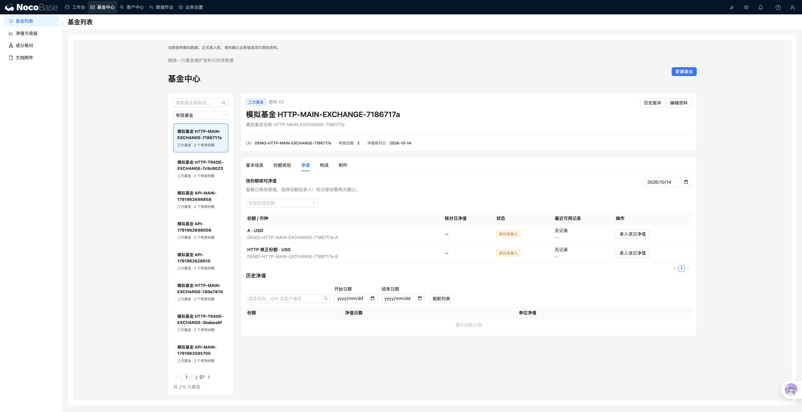

# Finance 原生双导航迁移

2026-10-14。本机 NocoBase 2.2.24，官方 nb CLI 2.2.24。迁移前代码快照：`175c1f4`。

## 已完成的范围

使用官方 AdminLayout 的混合布局：顶部选择业务分组，左侧选择该组页面。菜单、页面、权限和界面配置入口由 NocoBase 提供；Finance 以官方 BlockModel 扩展机制注册业务区块，复用原有录入表单、校验和领域接口。未修改平台源码，也没有另做一套顶部导航。

| 顶部菜单 | 左侧页面 |
| --- | --- |
| 工作台 | 总览、个人草稿 |
| 基金中心 | 基金列表、净值与收益、成分核对、文档附件 |
| 客户中心 | 客户与主体、持仓核对 |
| 数据作业 | 交易录入、导入中心、数据质量、数据导出 |
| 业务设置 | 设置概览、字段候选配置、基准数据、基金资料管理 |

共 16 个原生页面，每页挂载一个对应 Finance 区块。用户仍可通过官方“界面配置”管理页面和区块；区块内部的业务表单由插件代码维护，并非全部转成低代码 CRUD。

本机工作台：<http://127.0.0.1:13000/admin/7kc2t4rjohl>。原入口 `/admin/finance` 会跳转到可访问的原生页面。基金、份额、期间、导入批次和来源定位参数随业务跳转传递。原页面保留为兼容入口：`/admin/finance?legacy=1` 可停留在旧首页；其业务链接仍优先使用已安装的原生页面。

页面发现使用 `desktopRoutes.options.financePage` 的稳定标识，不依赖菜单显示名称。页面 UID 与本机安装位置见 [installed-pages.json](navigation/installed-pages.json)。这些 ID 属于当前数据库，不可直接用于另一套数据库。

## 权限

`finance_reader` 与 `finance_editor` 可进入业务页面，字段候选配置仅向 `finance_configurator` 开放。只读角色在导入页面看到权限说明，不能提交。菜单权限只决定入口；Finance 后端继续校验写入和配置权限。没有给 `finance_product` 标记角色增加业务入口。

## 重建与恢复

菜单、页面、区块实例和角色授权保存在数据库中，Git 只保存插件代码和安装说明。复制仓库不能代替数据库备份。整机迁移遵循 [部署与恢复](部署与恢复.md)，同时备份数据库、文件和必要私密配置。

在已完成 Finance 安装、连接正确 nb 环境并构建插件的实例中，可用以下步骤补建页面：

1. 执行 `python3 scripts/setup-native-navigation.py`。脚本通过官方 CLI 补建菜单和页面，优先匹配稳定标识，不替换已有页面。它仅适用于已验证的单桌面布局；能力不匹配时停止。
2. 用管理员进入官方“界面配置”，为尚未挂载区块的每个页面选择“创建区块 → Finance 对应页面”。16 个区块类型与页面对应关系见插件 `src/shared/navigation.json`。不要在已有区块的页面重复添加。
3. 再次执行该脚本，更新 `docs/navigation/installed-pages.json` 中的区块 UID、页面和标签路由 ID，以及两份 `access-*.json`。
4. 在目标实例确认角色职责后，用官方 ACL 命令增加页面权限：

```sh
nb api acl roles desktop-routes add --role-name finance_reader --body-file docs/navigation/access-business.json -j
nb api acl roles desktop-routes add --role-name finance_editor --body-file docs/navigation/access-business.json -j
nb api acl roles desktop-routes add --role-name finance_configurator --body-file docs/navigation/access-configurator.json -j
```

5. 在官方菜单配置中确认顶部顺序为工作台、基金中心、客户中心、数据作业、业务设置。本机已完成此排序。

脚本不自动挂载区块或修改角色权限。它需要管理员级菜单读取权限；应先确认 CLI 指向目标实例。恢复已有数据库时通常不需要重新建页面。

## 本轮验证

- 插件构建通过。
- Node.js 24 环境下，22 项 HTTP 测试通过，无跳过。新增测试验证只读、编辑、配置及无业务权限角色的导航边界。
- 16 个页面均读取到唯一的预期 Finance 区块，浏览器检查均可显示业务内容。
- 实际验证：工作台 → 基金详情 → 净值录入并保存；工作台 → 导入批次，刷新后保持批次；数据质量 → 字段候选配置，正确打开目标字段；基金详情刷新保持基金和标签；浏览器返回工作台；旧入口自动跳转。
- 基金净值长小数保存验证使用模拟数据。截图中搜索、日期和刷新控件底部对齐。
- 安装脚本重复执行通过；原有区块 UID 保持不变。

本轮未重跑历史 136 项领域／数据库测试、全量浏览器场景、性能和备份恢复验收；未更新发布包。报告计算与 Slides 仍属于下一阶段。


