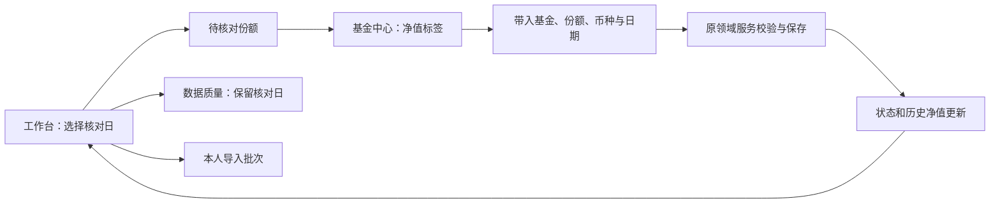

# Finance 页面流程样稿

日期：2026-10-14。基于现有 NocoBase 2.2.24 / `@finance/plugin-core`，使用本机模拟数据。

## 本轮范围

已实现可运行的“工作台 → 基金详情 → 净值录入”流程。业务字段、表关系和原写入规则保持现有设计；新增页面组织和只读核对查询。

入口：[工作台](http://127.0.0.1:13000/admin/finance?page=home)。旧标签若仍显示旧界面，刷新一次。

| 页面 | 本轮结果 |
| --- | --- |
| 工作台 | 按核对日展示未录入净值的有效份额、已有校验问题、本人最近导入。点击待核对行定位基金及份额。 |
| 基金中心 | 左侧搜索、分页和状态筛选；右侧基金摘要、基本信息、份额类别、净值、构成、附件。当前基金不在列表页时单独标明。 |
| 净值录入 | 带入份额、币种、日期及最近可用原值；保存后更新状态和历史列表。同日修改、草稿、并发校验继续走原流程。 |
| 客户中心、交易录入、导入中心、数据质量 | 收进统一业务导航，复用现有页面。客户摘要和标签布局、交易旁栏、导入步骤视觉仍待后续细化。 |
| 系统设置 | 集中候选配置、基金资料管理、基准管理和平台设置入口。平台设置在新标签打开。 |

个人草稿、全量净值与收益、数据导出保留为数据工具入口。

## 用户操作

1. 在工作台选择净值核对日，查看“待核对净值”。
2. 点击“进入核对”，进入对应基金的净值标签，并筛选对应份额。
3. 点击“录入该日净值”，核对基金、份额、币种和披露日期，填写原始数值。
4. 保存后查看已录入状态与历史净值。同日记录已存在时，先确认原值和新值；取消后原记录不变。
5. 返回工作台处理下一份额。修改但未保存的表单关闭时，可继续、放弃本次输入或保存个人草稿。

## 数据口径与技术边界

- “核对日未录入净值”指有效基金下的有效份额在指定日期没有记录。它不是逾期或报告缺数判定，不推断月末披露期限。
- “最近可用记录”只取不晚于核对日的净值；历史列表则可查看该份额全部日期。
- 新增只读 `finance:navCoverage`，支持日期、基金、份额、状态、搜索及分页。统计和列表使用同一数据库快照；数值按文本返回，保留精度。
- 现有 Finance 读取授权继续控制接口；无写权限时禁用录入，服务端仍检查写入。没有新增 Collection、迁移或角色授权。
- URL 的 `page`、`fund`、`section`、`share`、`date` 保存主要页面上下文。刷新和浏览器返回可恢复；基金列表搜索与分页是当前页面状态，不承诺刷新后恢复。
- 样式使用 NocoBase / Ant Design 主题变量。页面结构由 Finance 插件维护；主题配置负责公共颜色、边框及背景。

## 本轮验证

| 验证 | 结果 |
| --- | --- |
| 插件构建及类型声明 | 通过 |
| 领域与 PostgreSQL 测试 | 136 / 136 通过 |
| HTTP 测试 | 21 / 21 通过 |
| 浏览器主流程 | 定位份额、录入保存、历史更新、取消同日覆盖、关闭未保存表单、搜索、标签切换、刷新与返回定位均已操作核对 |
| 日期传递 | 日期选择器切换到 2026-10-13，数据质量页沿用相同日期；已恢复到 2026-10-14 |

新增自动用例覆盖精确日期、分页、停用排除、未来净值排除、保存后统计、非法参数及读取／写入权限。构建存在打包警告，未产生构建失败。

浏览器使用既有模拟基金 `API-1791880725137` 的 A 份额，新增 2026-10-14 净值 `1.23456789012345`。试改为 `1.35` 后取消，原值保留。这些记录用于技术验证。

本轮没有重跑历史 69 段浏览器脚本、隔离安装、规模性能和备份恢复。此前 M5 证据及发布包代表当时版本；本轮样稿位于当前工作目录，尚未重新打包发布。

截图：[工作台](verification/finance-flow/工作台.jpg)、[基金中心](verification/finance-flow/基金中心.jpg)、[净值录入](verification/finance-flow/净值录入.jpg)。本机日志：`.runtime/finance-layout-tests.log`、`.runtime/finance-layout-api.log`、`.runtime/finance-layout-build.log`。

下一轮先依据此流程样稿核对导航、信息密度和录入体验，再细化客户中心、交易录入及导入步骤。报告取数与 slides 仍属于第二阶段。

## 筛选栏对齐修正（2026-10-14）

历史净值的日期控件带有上方标签，原筛选栏采用顶部对齐，导致搜索框和刷新按钮偏高。共享 `QueryTable` 已改为底部对齐，横向与换行间距统一为 12px。逐页核对基金中心、客户、持仓、交易、净值、收益、草稿、基金管理、基准定义和基准数值，同一行控件底边一致。数据质量原已底部对齐；导入选择区和带日期的导出条件未发现同类错位。插件构建通过，页面无控制台错误；本次仅调整布局，未重跑业务测试。见[修正截图](verification/finance-flow/筛选栏对齐.jpg)和[页面检查记录](verification/finance-flow/筛选栏检查.json)。
